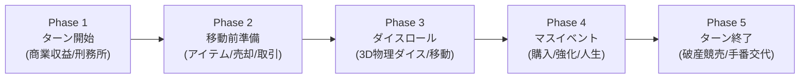

# 🎲 Life Board（ライフボード）- 3Dオンラインボードゲーム

モノポリー（不動産投資・エリア独占・競売）と人生ゲーム（職業キャリア・昇進・結婚・出産・人生イベント）を高次元で融合させた、**Three.js + Cannon-es + WebRTC (PeerJS) + Vite + TypeScript** 製のフルスタックWeb3Dオンラインボードゲームです。

ブラウザだけでPC・スマートフォンから動作し、最大6人（オンライン友達対戦 ＆ 賢いCPU対戦）で白熱したマネーバトルを楽しめます。

---

## 🌟 主な特徴・最新機能

1. **Monopoly GO調 3D都市ジオラマ & クローズアップカメラ**
   - 太陽光シャドウ、水面シェーダー、空色グラデーション、外周ストリート（走るイエローキャブ、街灯、地下鉄入口）をリアルタイム描画。
   - プレイヤーコマが放物線を描いてジャンプするホップアニメーション、建物のバウンス建設演出、紙吹雪・コイン花火のJuice演出。
2. **360度フリーカメラ＆マップ見回りシステム**
   - 右ドラッグ / `WASD` / 矢印キーで注視点を前後左右にスライド移動。
   - 左ドラッグで360度オービット旋回、マウスホイールで超クローズアップ（距離10）〜全体俯瞰（距離56）まで自由にズーム。
   - 「📍 自コマに戻る」ボタンや `Space` キーでいつでも自キャラへ瞬時に復帰可能。ダイスロール時も自動復帰。
3. **画面UIスケーリング（サイズ変更）機能**
   - プレイ中、画面上部中央の「⚙️ 設定」ボタンから、UIの大きさを **70% 〜 130%** までリアルタイムに無段階調整可能。
   - 「小さめ (80%)」「標準 (100%)」「大きめ (120%)」のワンタッププリセットを搭載。好みのサイズはブラウザに自動保存。
4. **Google OAuth ログイン ＆ Supabase クラウドプロファイル連携**
   - Googleアカウントで安全ログイン。所持ライフコイン、対戦成績、アンロック済みスキンがクラウドに保存。
   - 4種類の豪華トークンスキン（スタンダード、ゴールド、ロイヤルクラウン、サイバーネオン）をコレクション可能。
5. **物件購入時の3Dミニチュアイラスト表示**
   - 全7エリア（グリーンパーク、サンシャイン、アクアウォーター、メトロポリタン、ロイヤル、ゴールドヒルズ、スペシャリティ）ごとに異なるハイクオリティな3Dミニチュア建築CGがダイアログに表示。
6. **管理者専用 開発者モード（Developer Console）**
   - 特定の管理者アカウントでログイン時のみ有効化。
   - 資産の増減（現金・ライフコイン）、全スキンの自由切替、出目1〜6のイカサマダイス、指定マスへのワープ。
   - 全36マス一覧テーブル＆マスの既存種類への任意リプレイス（3Dビル・タイル・エフェクトのリアルタイム建て替え同期）。
7. **サーバーレスP2Pオンライン対戦**
   - WebRTC (PeerJS) を採用。招待URLを送るだけでバックエンド不要・完全無料で友達とリアルタイム対戦可能。
   - 空き枠には「＋ CPU追加」でAIを自由に追加可能（1人プレイも完全対応）。

---

## 📖 ゲームルール＆システム完全ガイド

### 1. 🏆 勝利条件
ゲーム終了時（規定ターン終了、または制限時間終了時）に、**「総純資産」**が最も多いプレイヤーが勝者となります！

$$\text{総純資産} = \text{所持現金} + \text{所有物件の評価額合計} + \text{永続型アイテムの評価額合計}$$

- 任意のタイミングで破産者が出た場合、そのプレイヤーは脱落となり、所有物件は公開競売にかけられます。

### 2. 🗺️ マスの種類と効果（全36マス）

| マス種別 | 個数 | 効果・詳細 |
| :--- | :---: | :--- |
| **START** | 1 | スタート地点。通過・停止時に給料（職業ランクに応じた金額）と家族手当を精算。 |
| **物件マス (Property)** | 18 | 住宅地・商業施設・特殊物件。未所有時は購入可能。再停止でLv2・Lv3へ強化。他人が止まると通行料を徴収！同色エリア全独占で収益1.5倍。 |
| **キャリアマス (Career)** | 3 | 就職・転職・昇進試験。ランクが上がると給料や物件所有上限がアップし、固有パッシブスキルが強化。 |
| **ライフマス (Life)** | 3 | 結婚、出産、記念日、宝くじ当選など人生を彩るイベントが発生。ご祝儀や臨時収入・支出。 |
| **チャンスマス (Chance)** | 4 | ランダムカードを引く。ワープ、他プレイヤーからの徴収、物件の無償強化など一発逆転のチャンス。 |
| **ショップマス (Shop)** | 2 | 移動前消費アイテム（シールド、割引券、指定出目カード）や永続資産アイテム（高級車、アート）を購入。 |
| **税務署マス (Tax)** | 2 | 純資産に応じた所得税・資産税を支払う。 |
| **刑務所マス (Jail)** | 1 | 収監されると最大3ターン行動制限。保釈金300万円、脱獄カード、またはダイスゾロ目/出目6で脱出。 |
| **刑務所送り (Go To Jail)**| 1 | 止まった瞬間に即座に刑務所マスへ強制連行される。 |
| **フリーパーキング (Rest)** | 1 | 休息広場。ペナルティなし。プールされた税金やボーナス金を受け取れる。 |

### 3. 🔄 1ターンの進行フロー（5フェーズ）



1. **Phase 1: ターン開始**
   - 商業施設を所有している場合、定期収益が自動で入金されます。
   - 刑務所収監中の場合、脱出方法（保釈金300万支払い / 脱獄カード使用 / サイコロ出目6挑戦）を選択します。
2. **Phase 2: 移動前準備**
   - 所持している消費アイテム（通行料シールド、指定出目カード等）を使用できます（1ターン1回）。
   - 資金繰りのため、所有物件を銀行へ売却（総投資額の70%）できます。
   - 他プレイヤーへ物件や現金の交換を持ちかける「トレード（取引）申請」が可能です。
3. **Phase 3: 移動**
   - 「サイコロを振る」ボタンを押すと、Cannon-es物理エンジンによる3Dサイコロが転がります。
   - 出た目の数だけキャラクターが放物線ジャンプでマスを進みます。
   - 分岐点に達した場合は進みたいルートを選択できます。
   - スタート地点を通過すると給料を獲得し、配偶者・子供の生活費が精算されます。
4. **Phase 4: 移動後アクション**
   - 止まったマスの効果が発動します。
   - 空き物件なら「購入」、自分の物件なら「増築（Lv2・Lv3）」、他人の物件なら「通行料支払い」。
   - キャリア・ライフ・チャンス・ショップなどの固有イベントダイアログを処理します。
5. **Phase 5: ターン終了**
   - 所持金がマイナスになったプレイヤーは物件売却で返済を試みます。それでも返済できない場合は**破産**となります。
   - 破産したプレイヤーの物件は、強化レベルを維持したまま全員参加の**「ターン制公開競売」**にかけられます！
   - 全てのアクションが終了したら、次のプレイヤーへ手番が移ります。

---

## 💼 職業キャリア＆パッシブ能力（全8職種）

プレイヤーはゲーム開始時は「フリーター」ですが、キャリアマスで様々な職種に就職・転職できます。

| 職業 | 特徴 | 固有パッシブ能力 |
| :--- | :--- | :--- |
| **会社員** | 堅実・安定型 | スタート通過時の給料が常に10%ボーナス |
| **公務員** | 守り・減税型 | 税務署マスで支払う税金が常に半額（50%OFF） |
| **ITエンジニア** | 割引・テック型 | 物件購入時および増築レベルアップ時の費用が10%割引 |
| **医師** | 超高収入・エリート | 全職種中トップクラスの高給取りだが、転職条件が厳しい |
| **弁護士** | 交渉・トラブル回避 | 刑務所マスに止まっても即座に無償で釈放 |
| **投資家** | 資産運用型 | 商業施設の定期収益が1.3倍に増加 |
| **起業家** | ハイリスク・ハイリターン | 所有物件の通行料収入が1.2倍に上昇 |
| **アーティスト** | 一発逆転型 | チャンスカードで良いイベントを引く確率が上昇 |

---

## 🎮 操作方法一覧

| 操作 | 動作 | 詳細 |
| :--- | :--- | :--- |
| **マウス右ドラッグ**<br>*(または Shift + 左ドラッグ)* | **水平パン移動** | カメラの向きに合わせて注視点が前後左右に移動し、マップや街並みを自由に探索（右クリックメニューは抑止）。 |
| **キーボード `W` `A` `S` `D` / 矢印キー** | **水平パン移動** | キーボード入力でもスムーズにマップ全体を見回せます。 |
| **マウス左ドラッグ** | **360度オービット旋回** | カメラの角度（左右・見下ろし角）を360度スムーズに回転。 |
| **マウスホイール** | **スムーズズーム** | クローズアップ（距離10）から全体俯瞰（距離56）まで滑らかに拡大縮小。 |
| **「📍 自コマに戻る」ボタン / `Space` キー** | **自キャラ注視に即復帰** | 画面上部のボタンまたは `Space` キーで、自キャラのコマへ瞬時にカメラを戻せます。 |
| **マスをクリック** | **マス詳細表示** | 物件情報、Lv1〜Lv3の通行料表、所有者、エリア独占状況を詳細ポップアップ表示。 |
| **画面上部「⚙️ 設定」** | **UIサイズ・音量設定** | 画面UIの大きさ（70%〜130%）をリアルタイムに変更できます。 |

---

## 🛠️ 開発者モード（Developer Console）

管理者としてログイン（またはローカル開発環境で許可されたアカウント）した場合、ゲーム画面右上に「🛠️ DEV」ボタンが表示されます。

- **コア操作**:
  - 現金・ライフコインの即時増減（+1,000万、+5,000万など）
  - スキンの即時着せ替え（未解放スキンもテスト可能）
  - 次の出目強制指定（イカサマダイス 1〜6）
  - 指定マス番号への強制テレポート
- **マス編集・盤面テスト**:
  - 全36マスの種別・価格・レベル・所有者一覧テーブル閲覧
  - 任意のマスを既存の別マス種別へリアルタイム変更（3Dビル・タイルテクスチャ・花火演出が即座に同期）

---

## 🚀 ローカル起動＆ビルド方法

```bash
# 依存パッケージのインストール
npm install

# 開発サーバーの起動（http://localhost:5173）
npm run dev

# TypeScript型チェック＆本番バンドル
npm run build

# ビルド成果物のローカルプレビュー
npm run preview
```

---

## 🌐 Vercelへデプロイしてオンライン対戦する方法

本プロジェクトは **WebRTC (PeerJS) によるサーバーレスP2Pホスト権威モデル** を採用しており、**バックエンドサーバー不要・Vercelへのフロントエンドデプロイのみ（完全無料）** で対戦できます。

1. **Vercelへデプロイ**:
   - リポジトリをGitHubにプッシュし、VercelでプロジェクトをImportします。
2. **友達を部屋に招待**:
   - ホストがタイトルからロビーに入ると、自動的に6桁のルームIDが発行されます。
   - 「🔗 招待URLコピー」をクリックし、友達に共有します（例: `https://your-domain.vercel.app/?room=123456`）。
3. **対戦開始**:
   - 友達がURLを開くと自動で合流。「＋ CPU追加」でAIを交えながら「ゲーム開始」を押すだけでリアルタイム対戦が始まります。

---

## 📁 関連仕様書・設計ドキュメント一覧

- [docs/gdd.md](file:///c:/Users/t25j423/Desktop/life_game/docs/gdd.md) - 全体ゲームデザイン仕様書（ルール、フェーズ、3D演出、経済バランス）
- [docs/developer-tools-spec.md](file:///c:/Users/t25j423/Desktop/life_game/docs/developer-tools-spec.md) - 開発者モード・デバッグツール設計仕様書
- [docs/free-camera-spec.md](file:///c:/Users/t25j423/Desktop/life_game/docs/free-camera-spec.md) - フリーカメラ・マップ見回り操作仕様書
- [docs/design-spec.md](file:///c:/Users/t25j423/Desktop/life_game/docs/design-spec.md) - トイポップ調UI/UXデザイン仕様書
- [docs/qa-report.md](file:///c:/Users/t25j423/Desktop/life_game/docs/qa-report.md) - QA品質検証・動作確認レポート
