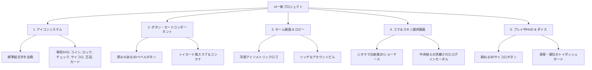

# 🎲 Life Board 新UI/UXデザイン仕様書 (Design Spec)

添付画像（Monopoly GO / ダイスドリームズ調の立体アイソメトリック・ジオラマボードゲーム）の質感に基づき、既存の「Web管理画面風・単調な白カード・標準絵文字」を完全排除し、**「おもちゃ箱を開けたようなワクワク感と触り心地（Tactile）のある高品質ゲームUI」**へフルリニューアルします。

---

## 1. ビジュアルコンセプト & トーン＆マナー

### 🌟 コンセプトキーワード
- **Isometric Toy Diorama（アイソメトリック・トイ・ジオラマ）**
- **Chunky & Tactile（厚みと手触りのあるパーツ・押して気持ちいいベベル）**
- **Vibrant & Glossy（みずみずしい発色、ハイライト、ゴールド・宝石の輝き）**
- **Clean Game Typography（袋文字・太いストローク・迫力のある数値表現）**

### ❌ 排除する「安っぽさ（AI/Web感）」
1. **OS標準絵文字の全面廃止**: `🪙`, `🔐`, `✅`, `♟️`, `👑` などの絵文字を一切使わず、ゲームの世界観に統一されたリッチな**専用ベクター（SVG）アイコン**を使用。
2. **Webフォーム風のフラットな白背景・極細線の廃止**: カードやボタンに厚み（下側の暗色シャドウ押し出し層）と外枠の白いふちどり（ホワイトストローク）、光沢ハイライトを付与。
3. **無機質なゴシック体の廃止**: 数字は太く力強いジオメトリック書体（ポーンやコイン、資産が直感的に目に入るデザイン）、見出しはゲームらしいエンボス・ドロップシャドウを効かせたタイポグラフィへ。

---

## 2. デザイントークン (Design Tokens)

### 2.1 カラーパレット
| トークン名 | カラーコード | 役割 |
| :--- | :--- | :--- |
| **Sky Vivid (背景・基調)** | `#38bdf8` 〜 `#0284c7` | 抜けるような青空・爽快なジオラマ空間の背景グラデーション |
| **Board Grass (フィールド)** | `#84cc16` 〜 `#4d7c0f` | みずみずしい芝生、ボード天面の生き生きとした黄緑 |
| **Button Gold (メイン決定)** | `#facc15`（影: `#ca8a04`, 枠: `#fef08a`） | 押し出し感のある黄金イエロー。サイコロ、ゲーム開始、決定 |
| **Action Blue (セカンダリ)** | `#3b82f6`（影: `#1d4ed8`, 枠: `#93c5fd`） | ルーム作成・参加、設定、主要アクション |
| **Card Surface (パネル)** | `#ffffff`（ベベル影: `#cbd5e1`, 境界線: 3px） | プラスチック・トイカードのような丸みと厚みのあるサーフェス |
| **Accent Gem (ジュエル・紫)** | `#c084fc` 〜 `#9333ea` | イベントカード、特別スキン、プレミアム報酬 |
| **Coin Amber (ライフコイン)** | `#fbbf24` 〜 `#d97706` | コインアイコン専用の温かみのあるアンバーゴールド |

### 2.2 立体ボタン・カードの構造（Chunky 3D Bevel）
- **ボタンの押し出し表現 (Layered Bevel)**:
  - 通常時: `box-shadow: 0 6px 0 var(--btn-shadow), 0 10px 20px rgba(0,0,0,0.18);`
  - ホバー時: `transform: translateY(-2px); box-shadow: 0 8px 0 var(--btn-shadow), ...;`
  - クリック時（Active）: `transform: translateY(4px); box-shadow: 0 2px 0 var(--btn-shadow);`（実際にカチッと沈み込む触感）
- **ホワイトストローク＆インナーグロウ**:
  - 全てのボタンやバッジに `2px〜3px` の白フチと上面のハイライト線（`inset 0 2px 0 rgba(255,255,255,0.6)`）を設け、ジオラマパーツのようなソリッドな質感を演出。

---

## 3. UIコンポーネント一新の対象と仕様

### 3.1 アイコンシステム（標準絵文字の完全置換）
- `🪙 ライフコイン` ➔ **立体コインベクターアイコン（金貨の縁取りとハイライト入り）**
- `🔐 ログイン / ロック` ➔ **メタリック調の真鍮パドロック（錠前）アイコン**
- `✅ 装備済 / チェック` ➔ **立体グリーンの丸型チェックバッジ**
- `♟️ コマ / キャラ` ➔ **アクリル・木製トイポーンのシルエットアイコン**
- `👑 ホスト / 順位` ➔ **光沢ゴールドクラウンアイコン**
- `❓ イベントカード` ➔ **添付画像中央のような青色クエスチョンカードデッキ**

### 3.2 画面ごとのリニューアル計画

1. **タイトル＆モード選択画面（TITLE / MODE_SELECT）**
   - 添付写真のような「青空に浮かぶ浮島・ジオラマ」の奥行き感をCSSと背景で表現。
   - ボタンをトイブロックのような立体ピルボタンに刷新。
   - 左上のログインボタンを「Googleアイコン＋ゴールドコイン＋ステータス」のリッチバッジへ。

2. **コマ＆スキン選択画面（CHAR_SELECT）**
   - 左側のショーケース台座を「アイソメトリックな円形トイステージ」に強化。
   - コマの質感（光沢プラスチック・24Kゴールド・クリスタル・サイバー）のプレビューをより鮮明に。
   - ログインモーダルを中央配置＆リッチなカードスタイルへ。

3. **プレイ中のゲームHUD & サイコロ（GAME HUD）**
   - 右下のサイコロボタンを添付写真のように「立体的なドットが刻まれた跳ねる3Dダイス」デザインへ。
   - 上部プレイヤーバー（資産・所持金・順位）をボードゲームのスコアボード風にリッチ化。

