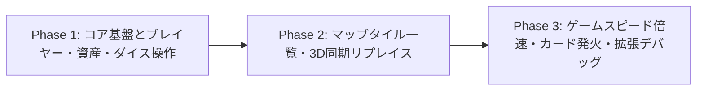

# 🛠️ 開発者モード・デバッグツール仕様書 (docs/developer-tools-spec.md)

本ドキュメントは、特定のアカウントでログインした際に使用可能となる「開発者専用モード（Developer Tools / Debug Console）」の要件定義、権限管理方式、および機能設計をまとめたものです。

---

## 1. 開発者権限（Admin / Developer）の判定方式（確定）

開発者ツールは一般プレイヤーには一切非公開とし、特定の管理者アカウントのみがアクセスできるように制御します。

- **メールアドレスホワイトリスト判定**:
  - `.env` に `VITE_DEV_ADMIN_EMAILS=user@example.com,...` を設定。
  - Supabase Google OAuth でログインしたユーザーの `session.user.email` が含まれている場合のみ `isDevAdmin = true` と判定。
  - 未ログイン時、またはリスト外のアカウントの場合は開発者ボタン・機能は完全非表示・無効化されます。

---

## 2. 開発者ツールのUIアクセス方法（確定：方式B）

- **画面UIボタン**:
  - 開発者ログイン中のみ、画面右上端に控えめな `🛠️ DEV` フローティングボタン、および `ESC` ポーズメニュー内に「🛠️ 開発者コンソールを開く」ボタンを配置。
- **デバッグコンソールUI**:
  - 画面右側からスムーズにスライドオーバーする半透明トイパネル。
  - タブ切り替え式：
    - `[プレイヤー/スキン]`
    - `[資産/マネー]`
    - `[マップ/タイル]`
    - `[進行/ダイス]`
    - `[システム/演出]`

---

## 3. 機能一覧と仕様案

### 3.1 プレイヤー・アピアランス操作
| 機能名 | 内容 | デバッグ用途 |
| :--- | :--- | :--- |
| **未解除スキンの強制解放** | 全スキン（純金ゴールド、クリスタル、ネオン等）を全解放状態にする | 未解放スキンのエフェクトや表示確認 |
| **インゲーム即時スキン変更** | ゲームプレイ中にその場で自キャラのスキン・トークン・カラーを即座に切り替える | ゲーム中のライティングやモデル表示確認 |
| **職業（Job）の即時変更** | 任意の職業（医師、IT起業家、不動産等）に即時変更・転職する | 職業パッシブスキルの動作検証 |

### 3.2 資産・経済バランス操作
| 機能名 | 内容 | デバッグ用途 |
| :--- | :--- | :--- |
| **所持金の自由増減** | `+1000万`、`+1億`、`-500万`、または任意金額を瞬時に入力反映 | 高額物件の購入テスト、破産処理の検証 |
| **物件の無償取得** | 止まっているマス、またはマップ上の任意の物件マスをワンクリックで自己所有にする | 物件独占ボーナスや通行料の計算検証 |
| **物件レベル即時最大化** | マップ上の自物件・他者物件のレベルを Lv1 ➔ Lv3（Hotel）へ無償で即時アップ | 3D建築モデルの増築演出や通行料徴収の検証 |
| **アイテム自由付与** | 全アイテム（割引チケット、ダイスコントローラー、シールド等）を自由に追加・個数操作 | アイテム使用効果のデバッグ |

### 3.3 マップ・タイル操作（★要望機能・3D同期連動）
| 機能名 | 内容 | デバッグ用途 |
| :--- | :--- | :--- |
| **生成タイル一覧ビューア** | マップ内の全マス（全36マス）のID、名前、種類、所有者、現在レベルを一覧テーブルで可視化 | マップ生成データと3Dメッシュの整合性確認 |
| **タイルの種類・属性を任意変更** | 任意のマスを選択し、既存のタイル種別（住宅地、商業ビル、チャンス、転職、給料、牢屋等）へ即時置換。**3D上の建物モデル・マス装飾も即座に再生成して同期** | 特殊マスイベントや各マスの動作テスト |
| **マスのオーナー強制移転** | 任意の物件マスの所有者をP1 / P2 / P3 / CPU / 未所有へワンクリックで切り替え | 他者マス停止時の通行料イベント確認 |

### 3.4 ゲーム進行・ダイス操作（デバッグ推奨機能）
| 機能名 | 内容 | デバッグ用途 |
| :--- | :--- | :--- |
| **ダイス出目の指定（イカサマダイス）** | 次のサイコロの出目を `1〜6`（または2個合計 `2〜12`）で直接指定 | 特定のマスにピンポイントで止まるテスト |
| **指定マスへの即時ワープ** | マップ上の任意のマスIDをクリックして、即座にコマをそこへ移動 | 長時間のプレイをせず目的のマスへ直行 |
| **ターン・フェーズ強制遷移** | 現在のターンプレイヤーの変更、CPUターンの即時終了、フェーズのリセット | 進行不能バグ発生時の復帰・検証 |

### 3.5 追加提案機能（ボードゲーム開発特化デバッグ）
| 機能名 | 内容 | デバッグ用途 |
| :--- | :--- | :--- |
| **1. ゲームスピード倍速（1x / 2x / 5x / 即時）** | 移動アニメーションや演出ウェイトを倍速またはスキップ | テンポの検証、長ターンテストの超高速化 |
| **2. チャンス・イベントカードの強制発火** | 全イベントカード（ボーナス、暴落、臨時課税等）から選んで即時実行 | 各カードイベントの挙動・バグ確認 |
| **3. 対戦相手（CPU/P2〜P4）のステータス強制操作** | 相手の所持金を0に設定、特定の物件を強制付与 | 破産処理、ゲームオーバー、通行料支払いのテスト |
| **4. ゲーム終了・リザルト画面の即時トリガー** | 最終ターンまたは勝敗決定状態を即座にシミュレート | 表彰式、獲得コイン計算、戦績保存の確認 |
| **5. デバッグフリーカメラ** | 通常の斜め見下ろし固定カメラを解除し、360度自由回転・パン操作 | マップ全域の3Dモデリングや配置の確認 |
| **6. 盤面状態のJSON保存・復元** | 現在の全プレイヤーとマスの状態をクリップボードに書き出し／読み込み | 特定のバグ発生盤面の即時再現 |

---

## 4. セキュリティと安全性の考慮

- **本番マルチプレイ（オンライン対戦）での無効化**:
  - オンライン対戦（Photon/WebRTC/WebSocket連携時）では他プレイヤーへの不当な干渉を防ぐため、ソロモード／CPU対戦／プライベートデバッグルームのみで有効化するガードを設定。
- **データ永続化の分離**:
  - デバッグで付与した一時的な所持金や未解除スキンが、クラウド上の本番セーブデータへ誤って永久保存されないよう、セーフガードフラグを設ける。

---

## 5. 決定事項まとめ・段階的実装ロードマップ

### 5.1 確定事項
1. **認証判定**: `.env` の `VITE_DEV_ADMIN_EMAILS` によるメールアドレスホワイトリスト照合。ローカル開発中（`DEV`）は即時テスト可能なトグルも併設。
2. **UI導線**: 開発者ログイン中のみ、画面右上端の `🛠️ DEV` ボタン、および `ESC` ポーズメニュー内の「🛠️ 開発者コンソール」から開閉。
3. **3Dマップ同期**: マスの種類を変更した際は、3Dマップ上の建物モデル・タイル装飾もリアルタイムで解体・再生成して同期。
4. **実装方針**: ご要望の基本機能および提案機能（全6種）をすべて順次実装。

### 5.2 段階的実装フェーズ

- **Phase 1（コア基盤＆即時操作系）: 【完了】**:
  - 開発者判定ロジック（`ProgressionManager.isDevAdmin()`）と `.env` の `VITE_DEV_ADMIN_EMAILS` 連携。
  - 画面右上端の `🛠️ DEV` フローティングボタン、ESCポーズメニュー導線、およびスライドオーバートイパネル（`DevConsole.ts`）の実装完了。
  - 対象プレイヤー切り替え（P1、CPU等）、未解放スキンの強制アンロック、ゲーム中の即時スキン・カラー・キャラクター変更。
  - 職業の即時転職。
  - 所持金増減（+500万、+1000万、+5000万、+1億、-500万、0円）。
  - 現在停止中マスの無償獲得、Lv3ホテルへの即時Max強化、手持ち物件一覧からの個別レベル変更・放棄。
  - 全アイテム（7種）の一括付与。
  - イカサマダイス（次回出目を1〜12で確定指定）。
  - マップ全マスから選んで指定マスへ即時テレポート（ワープ）。
  - ローカル開発用オーバーライドトグル。
  - **UIクリックイベント伝播の遮断と判定強化**: パネル全体での `stopPropagation`（背後のゲームHUDや3Dキャンバスへの突き抜け防止）、`z-index: 9001` への引き上げ、およびタブボタンのセグメントコントロール型への改善。
  - **インプレース更新＆独立ルートマウント化（チラつき・閉じる挙動の根絶）**: パネルDOMをゲームコンテナから切り離し `document.body` 直下の独立レイヤーに配置。操作時（所持金変更やタブ切替等）はパネル骨格を破棄せず内部コンテンツのみインプレース更新することで、スライドアニメーションの不要な再トリガーと一瞬閉じる現象を解消。

- **Phase 2（マップ・タイル全一覧＆3Dリアルタイム同期）: 【完了】**:
  - 開発者ツール内に「🗺️ マップ・マス」タブを新設。
  - **全36マス一覧テーブル**: マス番号、種類タグ、マス名称、所有者、状態（Lv/価格）を網羅したスクロールテーブルとフィルター機能（すべて／物件のみ／特殊マスのみ）。
  - **マスの種類（タイプ）任意リプレイス**: 選択したマスを全10種（物件、START/給料日、チャンス、キャリア、ファミリー、ボーナス、ショップ、税務署、刑務所、分岐）へ即時置換。物件時は建築タイプ（住宅地／商業ビル／特区）も指定可能。
  - **3Dマップリアルタイム建て替え同期**: マス置換と同時に `MainScene.refreshSingleTileMesh(tile)` が連動発火。3D上の古いタイルメッシュを破棄して新しい立体マスを即座に再生成し、パーティクル花火＆サウンド演出（`upgrade` SE）とともに華麗に建て替えが反映される。
  - **所有者・レベルの直接変更**: 選択マスの所有者をワンクリックで自分・CPU・未所有へ切り替え、建物をLv1〜Lv3（ホテル）へ直接アップグレード。
  - **ピンポイントワープ**: 選択中のマスへプレイヤーコマを即座にテレポート。

- **Phase 3（拡張デバッグ＆スピード操作）**:
  - ゲームスピード倍速機能（1x / 2x / 5x / 即時スキップ）。
  - チャンス・イベントカードの任意強制発火。
  - 対戦相手（CPU/P2〜P4）のステータス・所持金操作。
  - リザルト画面の即時トリガー。
  - デバッグフリーカメラ＆JSONスナップショット保存・復元。

