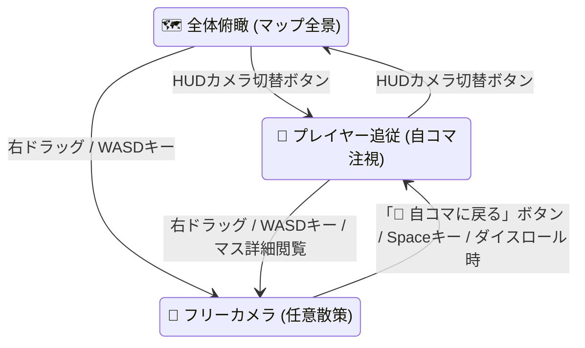

# 🎥 フリーカメラ・マップ見回り機能仕様書 (docs/free-camera-spec.md)

本ドキュメントは、プレイヤーが3Dボードマップの隅々や街並みジオラマ、他プレイヤーの現在地を自由に見回ることができる「フリーカメラ（Free Camera / Orbit & Pan Navigation）」の操作仕様およびUI設計をまとめたものです。

---

## 1. 概要と目的

ボード外周のストリート演出（イエローキャブ、街灯、地下鉄入口）やアイランド中央のジオラマ、各マスの建物を、プレイヤー自身の直感的な操作（マウスドラッグ・ホイール・キーボード）で360度自由に見渡せるようにします。

---

## 2. 操作仕様

| 操作方法 | 動作 | 詳細 |
| :--- | :--- | :--- |
| **左ボタンドラッグ** | **回転（オービット旋回）** | カメラの角度（水平角度 Yaw / 仰俯角 Pitch）を360度スムーズに回転。ドラッグ距離が短い場合はマス目クリック判定。 |
| **右ボタンドラッグ** *(または `Shift` + 左ドラッグ)* | **パン（注視点の水平移動）** | カメラの水平アングルに合わせて注視点（Target）を前後左右に平行移動。右クリック時のブラウザ標準メニューは抑止。 |
| **マウスホイール** | **スムーズズーム** | プレイヤーコマへのクローズアップ（最小距離 10）〜マップ全景の鳥瞰（最大距離 56）まで滑らかに拡縮。 |
| **キーボード `W` `A` `S` `D` / 矢印キー** | **カメラの前後左右パン移動** | 画面のカメラ向き（Yaw）に合わせてカメラ注視点をスライド移動。ズーム距離に応じて移動速度が自動スケール。 |
| **「📍 自コマに戻る」ボタン / `Space` キー** | **自キャラ注視にリセット** | パン移動後にワンクリック／Spaceキーで自キャラのコマへカメラをスムーズに復帰（`follow` モードへ）。 |

---

## 3. カメラモード遷移

1. **自動復帰（スマートアシスト）**:
   - フリーカメラで遠くを散策していても、**サイコロを振った瞬間**に自動で自コマ注視（`follow` モード）へ滑らかに復帰します。
2. **HUD上の「📍 自コマに戻る」ボタン**:
   - フリーカメラ中（`free` モード）は、上部中央のHUDに光る青色の「📍 自コマに戻る (Space)」ボタンが表示されます（画面の視界を遮らないよう、操作ガイド帯は非表示化）。
3. **境界クランプ**:
   - カメラの注視点（Target）はボードと周辺ジオラマが美しく収まる範囲（X/Z 各 ±36）に安全クランプされ、マップ外へ吹き飛ぶのを防ぎます。

---

## 4. 実装ファイル一覧

- `src/scenes/MainScene.ts`:
  - `CameraMode` 型の拡張 (`'overview' | 'follow' | 'free'`)
  - 右ドラッグ / Shift+左ドラッグによる `isPanningCamera` 水平パン移動計算
  - `activeKeys` による `WASD` / 矢印キー入力追跡と `updateKeyboardCameraPan`
  - `resetCameraToPlayer()` による自コマ注視への滑らかな復帰
  - `Space` キーによるワンキー復帰、ホイールズーム範囲の拡充（10〜56）
- `src/scenes/UIManager.ts`:
  - カメラ切替ボタン（`#btn-hud-camera`）の表示切り替え（全体俯瞰／プレイヤー追従／フリーカメラ）
  - 「📍 自コマに戻る (Space)」ボタン（`#btn-hud-camera-reset`）の追加とイベント紐付け
  - ゲーム中HUD上部バーへの「⚙️ 設定」ショートカットボタン（`#btn-hud-quick-settings`）の追加
  - 不要な操作ガイド帯（`#hud-cam-guide-pill`）の削除
- `src/style.css`:
  - `.cam-reset-btn`: パルス発光付きの目立つトイ風ボタン
