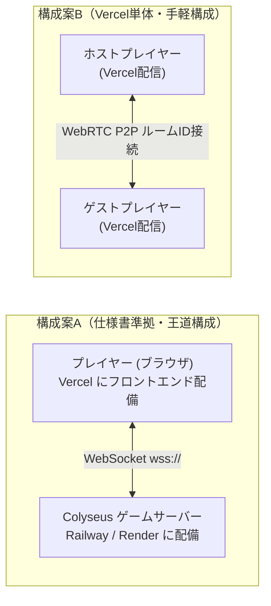

# Life Board - 3D-GDD（3Dゲームデザイン・設計仕様書）

> 本ドキュメントは、[online_board_game_spec_summary.md](../online_board_game_spec_summary.md) およびUIデザインリファレンス画像に基づき、`web-3d-game-create` オーケストレーション用に策定した3Dゲーム設計仕様書です。

---

## 1. プロダクト概要・世界観

- **タイトル**: **Life Board（ライフボード）**
- **ジャンル**: 3D不動産運用 × 人生キャリア・オンラインボードゲーム（モノポリー × 人生ゲーム）
- **ビジュアルトーン**:
  - 明るくクリーンなモダン・スタイライズド3D（爽やかなスカイブルーとホワイトを基調としたUI、緑豊かな街ジオラマとカラフルな立体ボードマス）
  - 4種類の個性豊かな3Dデフォルメキャラクター（カジュアル青年、制服少女、メガネ青年、ワンピース女性）＋5色のテーマカラー（ブルー、レッド、グリーン、イエロー、パープル）
- **プレイ人数**: 2人〜6人（オンラインマルチプレイ［Colyseus同期］＆ 1人でも即座に全機能をテスト・遊べるCPU/ローカルマルチ対応ハイブリッド構成）
- **勝敗条件**: ゲーム終了時（規定ターン消化 ／ 制限時間経過ラウンド終了 ／ サバイバル最後の1人）の **純資産額** で順位を決定

---

## 2. コアループと5フェーズ進行設計

### 2.1 純資産計算式（借金・担保廃止）
```text
純資産 = 所持現金 + 所有物件の評価額合計（基本購入価格 + 累積強化費用） + 永続型アイテムの評価額合計
```

### 2.2 1ターンの5フェーズ構成（制限時間：90秒 / AFK時5秒）

| フェーズ | フェーズ名 | 3D演出・カメラ・システム処理 |
| :--- | :--- | :--- |
| **Phase 1: ターン開始** | 状態確認・定期収支 | カメラが手番プレイヤーへズーム。商業施設の定期収益ポップアップ演出。刑務所収監時は脱出方法（保釈金300万 / 脱獄カード / 出目6挑戦）を選択 |
| **Phase 2: 移動前** | 戦略準備フェーズ | 俯瞰カメラ切り替え可能。消費アイテム使用（1ターン1回）、物件の銀行売却（総投資額の70%）、他プレイヤーとの取引申請（1ターン1回・応答20秒） |
| **Phase 3: 移動** | 3Dダイス＆移動 | Cannon-es 3D物理ダイス（1〜6等確率・サーバー乱数同期）をロール！コマが1マスずつホップ移動。分岐マス到達時はルート選択UI表示。スタート通過時に給料＋家族生活費精算 |
| **Phase 4: 移動後** | マス効果処理 | 停止マスのイベント発動（未所有物件購入、自己物件Lv2/Lv3強化＆3Dビル建設アニメーション、通行料支払い、キャリア・ファミリー・イベント・ショップ・税金・刑務所処理） |
| **Phase 5: ターン終了** | 終了処理 | 状態効果更新、破産時はターン制公開競売（開始価格50%、+50万円単位、15秒タイマー、Lv維持）を実行し、次のプレイヤーへ手番移行 |

---

## 3. 3Dボードマップ・カメラ・物理演出設計

### 3.1 3Dボード構造（Three.js）
- **マップ規模**: 1周 **36マス**（メイン周回ルート28マス ＋ 要所2箇所の分岐サブルート8マス［キャリア・イベント重視ルート / 不動産・商業重視ルート］）
- **中央ジオラマ**: ボード内側には緑の木々、道路、街並みモニュメント、噴水広場、水辺を立体配置し、リファレンス画像通りの箱庭都市を構築。
- **マス種別（全9種）と色分け**:
  1. **スタートマス**（ゴールド／ゲート装飾）：通過時に職業給料（無職は初回のみ失業手当100万円、2回目以降0円）と家族生活費（配偶者50万、子供1人50万）を精算
  2. **土地・物件マス（約45%）**：エリアグループ色分け（1グループ2〜3マス、独占で収益1.5倍）。住宅地（通行料20%/50%/100%）、商業施設（定期収益10%/20%/30%）、特殊物件（所有数倍率ボーナス）
  3. **イベントマス（約15%）**：ランダム即時イベント（60%）／選択型ルーレット判定イベント（40%）
  4. **キャリアマス（ファミリーと合算で約15%）**：全7職種（会社員、公務員、エンジニア、医者、不動産ブローカー、投資家、芸能人）への就職・転職・Rank 1〜3昇進
  5. **ファミリーマス**：結婚（配偶者最大1人・ご祝儀）、出産（子供最大3人・育児手当）、家族イベントボーナス
  6. **ボーナスマス（特殊合算で約25%）**：臨時報酬獲得
  7. **ショップマス**：消費型アイテム（指定出目カード、通行料半減シールド、物件割引チケット、脱獄カード）および永続型資産アイテム（高級腕時計300万、不動産資格証500万、自家用クルーザー1,000万）の売買（所持上限3個）
  8. **税金マス**：純資産に応じた税金支払い（公務員は30%〜50%軽減）
  9. **刑務所マス / 分岐マス**：収監（最大3ターン拘束、収監中も物件収益受取可、取引不可）およびルート分岐選択

### 3.2 物件レベル別3Dモデル変化
- **Lv1（初期購入）**: 小型ハウス／小型ショップ（1階建て立体メッシュ＋所有者のカラーフラッグ）
- **Lv2（強化1段階：基本価格×50%）**: 中型マンション／商業ビル（2〜3階建て複合メッシュ）
- **Lv3（強化2段階：基本価格×100%）**: ランドマークタワー／大型ショッピングモール（高層ビル＋屋上装飾＋発光サイン）

### 3.3 カメラ制御（スマートカメラシステム）
- **追従モード（Follow Cam）**: 手番プレイヤーの移動・ダイスロール時に滑らかなLerp補間で追従。
- **俯瞰・フリーモード（Overview / Orbit Cam）**: ボード全体を見渡せるアイソメトリック俯瞰視点。マウスドラッグ回転・ホイールズームで全マスの物件状況を自由に確認可能（観戦モードでも使用）。
- **スポットライト演出カメラ**: 物件建設時、結婚・昇進時、破産競売時に該当マスや対象へフォーカス＆3Dパーティクル放出。

### 3.4 3D物理（Cannon-es）
- **3Dダイス（ルーレット）物理演算**: ボード中央上で3Dサイコロが物理バウンドして転がり、サーバー/ロジックが決定した出目（1〜6）にピタッと着地・強調表示される演出。
- **コマのジャンプ移動＆ビル建設バウンス**: マス移動時の放物線ホップと着地パーティクル、物件建築時のスケールバウンス演出。

---

## 4. UI画面構成（リファレンス画像準拠）

1. **タイトル画面 (`TitleView` / `TITLE`)**:
   - 『Life Board』ロゴ＆立体ダイス、都市シルエット背景、「ゲームスタート >」「設定」「ヘルプ（ルール確認）」ボタン
   - 「ゲームスタート」押下時はいきなりルームを開設・開始せず、**ルーム選択画面（`MODE_SELECT`）**へ遷移する。
2. **ホーム／ルーム選択メニュー画面 (`ModeSelectView` / `MODE_SELECT`) - 添付リファレンス画像完全準拠**:
   - 背景：青空と白い雲、下部に広がる3Dミニチュア都市＆カラフルなすごろくボード（中央を囲む白枠カードは置かず、背景が全面に広がるオープンレイアウト）
   - 右上：白いピルバッジ「`Ver. 1.0.0`」
   - 中央上部ロゴエリア：
     - 立体3Dサイコロ（上面4・左面3・右面5、濃紺アウトライン）
     - ゴールドイエローの軌道リングと右上の2本キラリ装飾
     - 白太フチ付きの濃紺イタリックロゴ「**`Life Board`**」
     - サブタイトル「**`〜 人生をかけた、最高のすごろく 〜`**」
   - 中央下部・縦3段ピルボタンスタック（同一幅の立体ピルボタン3つ）：
     1. **「`＋ ルーム作成`」**（ブルーグラデーション立体ピルボタン）：押下すると**ロード画面（`LOADING`）**を経由して新規P2Pホスト部屋を開設し、ルームロビー（`LOBBY`）へ遷移する。
     2. **「`👥 ルーム参加`」**（ホワイト立体ピルボタン）：押下するとルームID入力モーダルを表示し、6桁のルームIDを入力して**ロード画面（`LOADING`）**経由で友達のルームロビーへ参加する。
     3. **「`⚙️ 設定`」**（ホワイト立体ピルボタン）：押下すると音量（BGM/SE）やルール確認ができる設定モーダルを開く。
   - **右下：選択中キャラクター表示ウィジェット (`HomeCharShowcase`)**:
     - ホーム画面右下に現在選択中のキャラクター全身立ち絵＋テーマカラー台座＋プレイヤー名＆「`👤 キャラ変更`」バッジを常時表示する。
     - ウィジェットをクリックすると独立した**キャラクター選択画面（`CHAR_SELECT`）**へ遷移し、キャラクター・テーマカラー・プレイヤー名を変更して「決定」を押すと元のホーム画面へ戻る。
3. **ロード画面 (`LoadingView` / `LOADING`)**:
   - ルーム作成時・ルーム参加接続時・およびロビーから3Dボードゲーム本編開始時の遷移間に表示される専用ローディング画面。
   - 立体ダイスのバウンスアニメーション、進行状況テキスト（「オンライン部屋を開設中...」「3D都市ジオラマを構築中...」等）、スムーズなプログレスバー（0%〜100%）、およびゲーム攻略に役立つ**ワンポイントTips（独占ボーナスや職業スキル等の解説）**を表示する。
4. **ルームロビー画面 (`LobbyView` / `LOBBY`) - 新デザインリファレンス準拠**:
   - **上部ヘッダーバー**:
     - 左上：「`← 戻る`」白いピルボタン（ルーム選択画面 `MODE_SELECT` へ戻る）
     - 中央：「🏠 **ルームロビー**」タイトル＋ブルーのアンダーライン装飾
     - 右上：「`ルームID : 12345` 📋」白いピルバッジ（コピーアイコンクリックで招待URL/ルームIDをコピー、または別ルームID入力参加モーダルを表示）
   - **中央左カード（ルーム概要パネル）**:
     - 左側：街並みと大きな白いサイコロの角丸サムネイル画像
     - 右側：編集可能なルームタイトル（「**たのしい人生ゲーム** ✏️」）、`🏁 ゲームモード`（規定ターン制 30ターン等）、`🕒 プレイ時間`（約30分）、`👥 参加人数`（2 / 6）
     - 下部バー：淡いブルーのステータスバー「`ℹ️ プレイヤーが集まるのを待っています...`」（友達のルームIDで参加するボタンも併設）
   - **中央右カード（参加プレイヤーパネル）**:
     - ブルーのヘッダー「`👥 参加プレイヤー`」
     - 6枠のリスト：参加済み枠はテーマカラーの丸ドットアイコン＋プレイヤー名＋ホスト王冠 `👑` のみでシンプルに表示（キャラクター選択はホーム画面右下からの専用画面で行うため、ロビー内でのキャラ変更ボタンは置かない）。空き枠はグレーのユーザーアイコン＋「`募集中...`」（ホストのみCPU/人間枠の追加・削除が可能）
   - **下部ボトムバー（開始・条件設定ドック）**:
     - 左側：「`⚙️ 終了条件`」ラベル＋「`🔄 規定ターン制 (30ターン)`」切替ピルボタン（クリックで規定ターン制10/20/30/50ターン・制限時間制15/30/45分をサイクル切替または選択）
     - 右側：ゴールドイエローの立体グラデーションボタン「**`▶ ゲーム開始`**」（ルーム待機中の開始制限時間は設けず、ホストが任意のタイミングで開始可能。押下時はロード画面 `LOADING` を経由してゲーム本編へ遷移）
5. **キャラクター（立体コマ＆スキン）選択画面 (`CharacterSelectView` / `CHAR_SELECT`) - ショーケース型新UI**:
   - ホーム画面右下の選択中コマウィジェットをクリックした際に開く専用画面。
   - **上部ヘッダーバー**：「`⬅ 戻る`」ボタン、タイトル「`♟️ コマ＆スキン選択`」、プレイヤー名入力欄、および現在所持している報酬通貨「`🪙 ライフコイン`」バッジを表示。
   - **左側：大型3Dショーケースプレビューエリア**：
     - 選択中の立体コマ（カラー＆特別スキン適用済み）の大型ビジュアル、コマの名称・称号・フレーバー解説、およびロック状態の場合は「`🔓 ライフコインで解放する`」ボタンを表示。
   - **右側：2タブ切り替えパネル**：
     - **タブ1「`♟️ コマ選択`」**：初期解放4種（①クラシックポーン ②スポーツカー ③クラウンナイト ④プライベートジェット）＋報酬解放コマ（⑤ラグジュアリークルーザー ⑥黄金キングクラウン）のカードグリッド。
     - **タブ2「`🎨 カラー＆スキン`」**：基本テーマカラー5色（ブルー・レッド・グリーン・イエロー・パープル）と、ライフコインで解放できる特別マテリアルスキン（スタンダード／メタリックゴールド／クリスタルダイヤ／ネオンサイバー）の選択リスト。
6. **メインゲームHUD (`BoardHUD` / `GAME`)**:
   - 左上：現在の手番プレイヤーカード（アバター、名前、所持金、職業・ランク、家族アイコン）
   - 上部中央：残り思考時間タイマー（「🎲 あと 60 秒」）＆ 現在ターン数 / フェーズ表示
   - 右側：全プレイヤー情報ダッシュボード（順位、名前、所持金、純資産、物件数/上限、アイテム数、接続状態。クリックで所有物件・独占詳細モーダル表示）
   - 左下：3Dダイス出目インジケーター ＋ メインアクションボタン（「サイコロを振る」「アイテム」「取引」「物件売却」「ターン終了」などフェーズ別表示）
   - 中央モーダル：物件購入・強化確認、選択型イベント、ショップ、プレイヤー間取引（20秒タイマー）、公開競売（15秒タイマー）、分岐選択矢印UI
7. **ゲーム結果画面 (`ResultView` / `RESULT`)**:
   - 最終純資産ランキング（1位〜6位、王冠アイコン、純資産総額）
   - **試合終了報酬（`🪙 ライフコイン`）獲得演出バナー**：最終順位ボーナス＋純資産ボーナス＋特別称号ボーナスを合算した獲得ライフコインを表示し、プレイヤーの所持コイン（`localStorage` 永続保存）へ自動加算する。
   - 選択プレイヤーの「資産内訳（現金・物件・アイテム）」円グラフ（SVG/Canvasチャート）
   - 特別称号表彰（不動産王、大家族賞、キャリアマスター、キャッシュキング）
   - 「ロビーに戻る」ボタン

---

## 5. 5つの専門3Dサブエージェント分担定義

| サブエージェント | 担当ファイル | 具体的な実装・生成内容 |
| :--- | :--- | :--- |
| **`game-3d-asset-specialist`** | `public/assets/textures/*`<br>`src/assets/asset-manifest.ts` | ・サブエージェント（`image-generator`等）による不足素材イメージ生成（タイトルロゴ背景、ロビー用街プレビュー、4キャラクター立ち絵＆アバター、地面・水面・ビル壁面テクスチャ）<br>・Three.js複合ジオメトリによる3Dキャラクターコマ（4種×5色）、物件ビルモデル（住宅・商業・特殊のLv1〜Lv3）、3Dダイス、木々・噴水・ゲート等のプロシージャルメッシュ生成ファクトリ |
| **`game-3d-audio-specialist`** | `src/audio/sound-manager.ts` | ・Web Audio API + `THREE.PositionalAudio` による立体音響＆プロシージャルサウンド合成<br>・サイコロ転がり音、コマ移動ホップ音、物件購入レジ音、ビル建設ファンファーレ、イベント成功/失敗ジングル、結婚・昇進祝福ファンファーレ、競売カウントダウン音、爽やかなシティポップ/ボードゲーム風BGMループ |
| **`game-3d-logic-specialist`** | `src/config/constants.ts`<br>`src/entities/*`<br>`src/systems/*`<br>`src/network/*` | ・確定仕様書（全9種マス、36マス＋2分岐マップ生成、5フェーズ管理、90秒/AFK5秒タイマー、全7職業×3ランク＆パッシブ能力、家族生活費、無職初回手当100万、住宅/商業/特殊物件＆独占1.5倍、破産判定＆ターン制公開競売、プレイヤー間取引、刑務所3ターン、純資産＆特別称号計算）の完全実装<br>・Colyseus状態同期クライアント＆サーバー（および単体起動ですぐ遊べるローカル/スマートAIプレイヤーエンジン）の統合<br>・Cannon-es 3Dダイス物理シミュレーション |
| **`game-3d-scene-specialist`** | `src/scenes/MainScene.ts`<br>`src/scenes/UIManager.ts`<br>`src/main.ts`<br>`src/style.css` | ・Three.js 3Dボードシーン構築（太陽光シャドウ、水面・空の演出、追従カメラ＆俯瞰Orbitカメラ切替、紙吹雪・コイン・建設パーティクル等のJuice演出）<br>・リファレンス画像完全準拠の5画面UI（タイトル、ルームロビー、キャラクター選択、メインHUD＋モーダル群、円グラフ付きゲーム結果画面） |
| **`game-3d-qa-specialist`** | `docs/qa-report.md` | ・`npx tsc --noEmit` および `npm run build` による静的型検査・バンドル検証<br>・アセットパス、3Dメモリ解放、ルール計算式の整合性チェックと自律修復ループ |

---

## 6. デプロイ・オンラインマルチプレイ通信アーキテクチャ設計

### 6.1 Vercelデプロイのメリット・デメリット（技術的特性）

| 項目 | 内容・影響 |
| :--- | :--- |
| **Vercelの強み（メリット）** | ・Three.jsの3Dアセット・静的フロントエンド（Viteビルド成果物）を高速CDNで無料配信できる。<br>・HTTPS（SSL）が自動適用され、URLを友達にシェアするだけで即アクセス可能。 |
| **Vercelの制約（デメリット1：WebSocket常駐不可）** | ・Vercelのバックエンド（Serverless Functions）は短時間で終了するステートレス仕様のため、**Colyseusのような「試合中（30〜45分間）常時接続を維持し、90秒ターンタイマーや部屋状態をメモリ保持するWebSocketゲームサーバー」をVercel単体で動かすことはできない**。 |
| **Vercel単体＋P2P方式にした場合のデメリット（デメリット2：ホスト依存）** | ・もしバックエンドサーバーを置かずWebRTC（PeerJS）等でVercel単体マルチプレイにした場合、**ホスト（部屋を作った人）がブラウザを閉じたり通信切断すると部屋全体が維持できなくなる**。また、厳格なファイアウォール環境ではP2P接続が失敗する場合がある。 |

---

### 6.2 友達とオンライン対戦するための推奨デプロイ構成（3案比較）



| 比較項目 | 【推奨案A】Vercel（フロント）＋ Railway / Render（Colyseusサーバー） | 【手軽案B】Vercel単体デプロイ ＋ WebRTC (PeerJS) P2P同期 | 【最小案C】Vercel単体デプロイ（1画面共有 / Discord等） |
| :--- | :--- | :--- | :--- |
| **特徴** | 確定仕様書（Colyseusサーバー権威型）を100%実現する本格オンライン構成 | サーバー代・バックエンド管理が完全ゼロ。Vercelに上げるだけで別端末対戦が可能 | 追加開発ゼロ。今すぐVercelに上げて1台の画面または画面共有で遊べる |
| **友達との遊び方** | 各自のPC/スマホでVercelのURLを開き、6桁のルームIDを入力して合流 | 各自のPC/スマホでVercelのURLを開き、6桁のルームIDを入力してP2P合流 | ロビーで「＋ 人間プレイヤー追加」を押し、順番に操作 |
| **切断・AFK耐性** | **◎ 非常に強い**（誰が切断してもサーバーが5秒AFK自動処理を引き継ぎ、いつでも再接続復帰可能） | **△ ホストに依存**（ゲスト切断時は復帰可能だが、ホストが閉じると試合終了） | **ー**（1端末で共有操作） |
| **デプロイの手間** | フロントをVercel、サーバー（`server/`）をRailwayまたはRenderへデプロイ（計2箇所） | **◎ Vercel 1箇所のみ**（静的ホスティングのみで完結） | **◎ Vercel 1箇所のみ** |
| **コスト** | フロント無料 ／ サーバーは月5ドル程度（またはRender等の無料枠※スリープあり） | **完全無料** | **完全無料** |

---

### 6.3 採用方式：案B（Vercel単体デプロイ ＋ PeerJS WebRTC P2Pホスト権威同期）詳細設計

ユーザーの選択に基づき、Vercel 1箇所への静的デプロイのみで友達と別々のPC・スマホからルームID（または招待URL）で通信対戦できる **PeerJS (WebRTC DataChannel) ホスト権威型P2P同期システム** を実装する。

#### 1. 接続・ルームID解決フロー
- **Peer ID命名規則**: ルームID `XXXXXX`（6桁英数字）に対し、ホストのPeer IDを `lifeboard-p2p-room-XXXXXX` とする。
- **ホスト（部屋作成者）**:
  - ロビーで「🌐 オンライン部屋を作成」またはデフォルト起動により、PeerJSで `lifeboard-p2p-room-{ROOM_ID}` をオープン。
  - 「🔗 招待URLをコピー」ボタンで `https://<デプロイ先URL>/?room={ROOM_ID}` をクリップボードにコピーし、友達に共有可能。
- **ゲスト（友達・参加者）**:
  - 招待URL（`?room=XXXXXX`）を開くか、ロビー画面上部の「🔑 ルームID入力」に6桁コードを入力して「参加」をクリックすると、ホストのPeerへWebRTC DataChannel接続を確立。
  - 空いているCPU枠または新規プレイヤー枠（最大6人）に人間プレイヤーとして割り当てられ、固有の `localPlayerId` を取得。

#### 2. P2Pメッセージプロトコル (`P2PMessage`)
- **ホスト → 全ゲスト配信 (`HostToClientMessage`)**:
  - `LOBBY_SYNC`: ロビー設定・参加プレイヤー一覧・ホスト状態の同期
  - `MATCH_START`: ゲーム開始通知（シード値、ルール設定、初期プレイヤーリスト、初期状態スナップショット）
  - `ENGINE_STATE_SYNC`: `GameEngine` の全状態スナップショット（タイル所有権・レベル、各プレイヤー資産・職業・家族・位置、現在フェーズ、各種モーダルコンテキスト、残り秒数）
  - `FX_DICE_ROLL`: 3D物理ダイスロール演出の同期発火
  - `FX_PLAYER_STEP`: 3Dキャラクターコマの1マスホップ移動アニメーション同期
  - `FX_POPUP`: 3D空間上の金額・祝福ポップアップエフェクト同期
  - `FX_LOG`: トースト＆ログ通知の同期
  - `MATCH_OVER`: ゲーム終了＆最終ランキング・特別称号の同期
- **ゲスト → ホスト送信 (`ClientToHostMessage`)**:
  - `JOIN_REQUEST`: プレイヤー名・希望キャラ・カラーでの参加または再接続リクエスト（保存済みセッションIDによる再接続復帰に対応）
  - `CUSTOMIZE_PLAYER`: ロビーでの名前・キャラクター・カラー変更
  - `PLAYER_ACTION`: ゲーム中の全17種プレイヤー操作コマンド（サイコロロール、刑務所選択、分岐選択、物件購入/強化/売却、キャリア選択、イベント選択、ショップ売買、トレード申請/応答、競売入札/パス、アイテム使用、ターン終了）のRPC送信

#### 3. 権威性と切断・再接続（仕様書13.1準拠）
- 乱数（サイコロ出目・イベント抽選）と90秒タイマーはすべて **ホスト側の `GameEngine` が一括管理（ホスト権威方式）** し、ゲスト側での不正や乱数ズレを防止。
- ゲストのWebRTC接続が切断された場合、ホスト側で該当プレイヤーの `isConnected = false` とし、5秒短縮タイマーによる自動進行を継続。ゲストが再度同じルームに接続すると元のプレイヤーIDに再バインドされ、手動操作へ復帰する。

---

## 7. 立体コマ（ポーン）一新 ＆ 報酬・アンロックシステム詳細設計

ヒアリング結果に基づき、従来の人物キャラクター立ち絵から **「ボードゲーム王道の立体コマ・ポーン調（ピン・乗り物・チェス紋章）」** へデザインを全面刷新し、試合終了後の報酬通貨（**ライフコイン**）で追加コマや特別スキンを解放できるコレクション要素を導入する。

### 7.1 立体コマ（ポーン）ラインナップ定義（初期4種 ＋ 報酬解放2種）

| コマID (`CharacterId`) | 名称 | 分類・初期状態 | モチーフ・3Dメッシュ造形 | 価格（ライフコイン） |
| :--- | :--- | :--- | :--- | :--- |
| **`char_1`** | **クラシック・ポーン** | 初期解放（基本4種） | 王道ボードゲームの美しい流線型ガラス/メタリック立体ピン | 初期解放（0 🪙） |
| **`char_2`** | **GTスポーツカー** | 初期解放（基本4種） | 人生ゲーム王道の流線型オープンカー／スポーツカー立体コマ | 初期解放（0 🪙） |
| **`char_3`** | **クラウン・ナイト** | 初期解放（基本4種） | チェスの騎士（ナイト）と王冠紋章を融合した気品ある立体コマ | 初期解放（0 🪙） |
| **`char_4`** | **スカイ・ジェット** | 初期解放（基本4種） | 世界を飛び回る流線型プライベートジェット立体コマ | 初期解放（0 🪙） |
| **`char_5`** | **ロイヤル・クルーザー** | 報酬アンロック枠 | 大海原とリゾートを制する豪華モーターヨット／クルーザー立体コマ | **300 🪙** |
| **`char_6`** | **エンペラー・クラウン** | 報酬アンロック枠 | 宝石と王冠が輝く最高峰の皇帝モノリス・トロフィー立体コマ | **500 🪙** |

### 7.2 特別スキン（マテリアル質感）ラインナップ定義

基本のテーマカラー5色（スカイブルー／コーラルレッド／エメラルドグリーン／サンシャインイエロー／ロイヤルパープル）に加え、3Dボード上のコマ質感および2Dショーケース見た目を変化させる **「スキン（Material Skin）」** を導入する。

| スキンID (`TokenSkinId`) | 名称 | 質感・3Dシェーダー/マテリアル効果 | 解放条件（ライフコイン） |
| :--- | :--- | :--- | :--- |
| **`standard`** | **スタンダード（艶ありグロス）** | 選択したテーマカラーが鮮やかに映える王道グロス塗装 | 初期解放（0 🪙） |
| **`metallic_gold`** | **純金ゴールド（24K Gold）** | 黄金の金属反射（高Metalness・低Roughness）＋ゴールド台座リング | **250 🪙** |
| **`crystal_prism`** | **クリスタル・プリズム** | 宝石のような半透明クリスタル質感＋淡い発光オーラ | **350 🪙** |
| **`neon_cyber`** | **ネオン・サイバーグロウ** | 鮮やかなネオン発光ライン（Emissive強）＋サイバー台座リング | **400 🪙** |

### 7.3 試合終了後の報酬通貨「ライフコイン（🪙）」獲得計算式

ゲーム結果画面（`RESULT`）到達時、ローカルプレイヤーの最終成績に応じて以下の計算式で「🪙 ライフコイン」を付与し、`localStorage`（キー：`lifeboard_progression_v1`）へ永続保存する。

- **順位ボーナス**:
  - 1位：**+150 🪙**
  - 2位：**+100 🪙**
  - 3位：**+70 🪙**
  - 4位以下（完走参加賞）：**+50 🪙**
- **純資産ボーナス**:
  - 最終純資産 1,000万円ごとに **+10 🪙**（例：純資産 3,500万円なら +35 🪙）
- **特別称号ボーナス**:
  - 特別称号（不動産王・大家族賞・キャリアマスター・キャッシュキング）獲得1つにつき **+30 🪙**

### 7.4 ショーケース型「コマ＆スキン選択画面（`CHAR_SELECT`）」UI設計

- **左側ペイン（大型3D風ショーケースステージ）**:
  - 回転・浮遊アニメーション付きの大型立体コマビジュアル（選択中のテーマカラー＆特別スキンエフェクトをリアルタイム反映）
  - コマ名称・称号バッジ・フレーバーテキスト
  - 未解放のコマまたはスキンを選択している場合は、下部に「`🔓 〇〇コインで解放する`」ボタン（未ログイン時は「`🔐 ログインして解放する`」ボタン）を表示
- **右側ペイン（2タブ切り替え式カスタマイズボード）**:
  - 上部に現在の所持コイン「`🪙 ライフコイン: XXX`」、ログイン状態バッジ、およびプレイヤー名入力ボックスを配置
  - **タブ1「`♟️ コマ選択（全6種）`」**：初期4種＋報酬解放2種のカードグリッド（ロック中アイテムには `🔒 300 🪙` バッジを表示）
  - **タブ2「`🎨 カラー＆特別スキン`」**：上段にテーマカラー5色スウォッチ、下段に特別スキン4種（スタンダード／純金ゴールド／クリスタル／ネオン）の選択・解放カードを配置
- **画面遷移・レイアウト設計ルール**:
  - **装備・設定変更時の画面維持**：解放済みのコマ・カラー・スキンをクリックした際、または右下の「このコマ＆スキンを装備する（`✅ 現在の装備に設定済み`）」ボタンを押した際は、**ホーム画面へ自動的に戻らず `CHAR_SELECT` 画面に留まったまま即座に装備を保存**する（左上の「`⬅ 戻る`」ボタンを押した時のみ前の画面へ戻る）。また、Google OAuth リダイレクト認証から復帰した際も `sessionStorage` により自動的に `CHAR_SELECT` 画面・選択中タブへ復帰する。
  - **見切れ防止のコンパクト設計**：左ペインのショーケースSVG（148px）と詳細ボックス、右ペインの3×2グリッド（66px SVG）の高さ・余白を最適化し、`overflow: hidden` による下部カードや説明文の見切れが発生しないレイアウトとする。

### 7.5 スキン・追加コマ解放時のログイン必須仕様（Supabase Auth ＋ Google OAuth連携）

- **ゲスト（未ログイン）状態のプレイ範囲**:
  - 未ログインのゲスト状態でも、初期解放されている基本4種の立体コマ（`char_1`〜`char_4`）と基本5色カラーを使って自由にルーム作成・参加・対戦が可能。
- **ホーム画面（`TITLE` / `MODE_SELECT`）のログインボタン配置**:
  - ホーム画面の**左上**に常時アクセス可能なアカウント連携ピルボタン（未ログイン時：`🔐 ログイン / アカウント連携`、ログイン済時：`🟢 メールアドレス 🪙 所持コイン`）を配置。
  - さらにタイトル画面のサブボタン列およびモード選択画面のメインメニュースタックにも「`🔐 ログイン`（ログイン済時は `🟢 アカウント連携済`）」ボタンを配置し、ホーム画面からいつでもワンクリックでGoogleログイン・連携状態の確認が可能。
- **ログインモーダルおよびショーケースUIの中央揃え設計**:
  - Googleログイン案内モーダル（`.login-required-modal-card`）は、ヘッダー見出し・リード文・特典リスト（`.login-benefit-box`）・下部アクションボタン（「キャンセル」＋「🌐 Googleでログインして連携」）をすべて**中央揃え（Center Alignment）**で統一し、ボタンが右端に偏ったり不自然に改行されたりしないレイアウトとする。
  - コマ＆スキン選択画面（`CHAR_SELECT`）左ペインのショーケース詳細情報ボックス（`.char-showcase-info-box`）も中央揃えで統一し、プレビュー立体コマとの視覚的バランスを整える。
- **ログイン必須トリガー（スキン・報酬コマの解放時）**:

---

## 8. 新UI/UXデザイン仕様（アイソメトリック・トイ・ジオラマ）

添付参考デザイン（Monopoly GO / ダイスドリームズ調の立体ボードゲーム）に基づき、UI/UXを抜本的に刷新する。詳細は [docs/design-spec.md](file:///c:/Users/t25j423/Desktop/life_game/docs/design-spec.md) に定義。

1. **OS標準絵文字の全面廃止**:
   - `🪙`, `🔐`, `✅`, `♟️`, `👑`, `🎲` などを全て廃止し、専用の立体リッチSVGアイコンコンポーネントに統一。
2. **アイソメトリック・トイ質感（厚みと手触り・Tactile）**:
   - ボタンには押し出し層（暗色の厚みシャドウ）と白フチ（2〜3pxストローク）、上面ハイライトを適用。
   - ホバー時に浮き上がり、クリック時にカチッと沈み込む触感を再現。
3. **鮮やかな発色と立体カード**:
   - 抜けるような空のブルー、芝生のフレッシュグリーン、ゴールドダイス、パープルジュエルカードなど、ゲームならではの鮮烈なパレットで構成。
4. **対象範囲**:
   - ホーム（TITLE / MODE_SELECT）、ルームロビー（LOBBY）、コマ＆スキン選択（CHAR_SELECT）、ゲーム中HUD＆サイコロ（GAME HUD）。

---

## 9. 3Dマップ＆物件購入UIリニューアル（浮島ジオラマ＆最小化UX）

詳細は [docs/map-redesign-spec.md](file:///c:/Users/t25j423/Desktop/life_game/docs/map-redesign-spec.md) に定義。

1. **物件購入モーダルの「最小化＆マップ見渡し」機能**:
   - 物件購入ダイアログのヘッダーに「🔍 マップを見渡す」トグルボタンを追加。
   - 最小化時は右下にトイカード風のコンパクトバーとして収納され、プレイヤーはボード全体をドラッグ操作で自由に旋回・ズームして確認できる。
2. **添付参考画像に基づく3D浮島ジオラマ（Island Slab）**:
   - 2段構造の厚みのある浮島（鮮やかなライムグリーン芝生＋パープルストーン層）。
   - 立体的なトイブロックマスとホワイトストローク道路。
   - ボード中央にアイソメトリックな「立体？カード山札デッキ」とトイツリーを配置。
3. **インゲームHUDの整理とESCポーズメニュー**:
   - 画面右下のハンバーガーメニュー（`☰`）ボタンを廃止し、HUDの視界をクリーン化。
   - `ESC` キーを押すことで、トイパネル調の「ポーズメニュー（設定・ヘルプ・対戦終了して退出）」を開閉可能にした。
4. **画面右下の行動ログパネルと表示／非表示トグル機能（中央下部ログの廃止・集約）**:
   - 画面中央下部に一時表示されていたトースト通知ログ（`.hud-bottom-center`）を廃止し、3Dマップやキャラクター・ダイス操作の視界を妨げないクリーンな画面構成に変更。
   - プレイヤーがサイコロを振った結果、移動、物件購入、給料受取などの全行動履歴は、画面右下のトイパネルに集約。
   - 各プレイヤーが「📜 行動ログ ▼/▲」ボタンをクリックすることで、いつでもログの表示／非表示を自由に切り替え可能。

---

## 10. Monopoly GO調 3Dマップ街路ジオラマ＆クローズアップカメラ仕様

詳細は [docs/monopoly-style-map-spec.md](file:///c:/Users/t25j423/Desktop/life_game/docs/monopoly-style-map-spec.md) に定義。

1. **臨場感のある斜め見下ろしクローズアップカメラ**:
   - FOV 32、距離 15.5、角度約39度により、プレイヤーのコマと進行方向のマス・街並みをダイナミックに捉える。
2. **ボード外周のストリートジオラマ演出**:
   - アスファルト車道、石畳歩道、イエローキャブ（ニューヨークタクシー）、街灯、地下鉄入口（SUBWAY）、オレンジの街路樹を配置。
3. **中央のダイススタジアム＆モノポリー調クラシックタイル**:
   - ボード中央にレンガ縁取りのダイストレイゾーンを配置。
   - タイルを鮮やかなグループカラー帯と白地プレートで統一。
  - **特別スキン（純金ゴールド／クリスタル・プリズム／ネオン・サイバー）および報酬コマ（ロイヤル・クルーザー／エンペラー・クラウン）を解放する際はログインを必須とする**。
  - 未ログイン状態でロック中のスキンやコマの「解放」ボタンを押した場合、自動的に **「ログイン案内モーダル（Googleアカウントでワンクリックログイン）」** が開く。
- **認証・クラウド保存基盤（Supabase）**:
  - **認証方式**: Supabase Auth による **Google OAuth ワンクリックログイン**（`supabase.auth.signInWithOAuth({ provider: 'google' })`）。
  - **環境変数（`.env`）**:
    - `VITE_SUPABASE_URL`: SupabaseプロジェクトURL
    - `VITE_SUPABASE_ANON_KEY`: Supabase Anon Public Key
    - ※開発時（環境変数未設定時）でもUI・解放フローを一貫してテストできるよう、ワンクリックで動作を確認できる開発用Googleログインシミュレーションフォールバックを内蔵する。
  - **クラウドDBテーブル（`public.user_profiles`）**:
    - `id` (`uuid`, Primary Key, `auth.users.id` 参照)
    - `display_name` (`text`)
    - `life_coins` (`integer`, デフォルト `300`)
    - `unlocked_characters` (`text[]`, デフォルト `['char_1','char_2','char_3','char_4']`)
    - `unlocked_skins` (`text[]`, デフォルト `['standard']`)
    - `selected_character` (`text`, デフォルト `'char_1'`)
    - `selected_color` (`text`, デフォルト `'blue'`)
    - `selected_skin` (`text`, デフォルト `'standard'`)
    - `updated_at` (`timestamptz`)

---

## 11. 物件購入・強化UIのミニチュア建築ビジュアル表示仕様

各物件マスに止まった際に出現する購入モーダルおよび強化モーダルにおいて、ボードゲームの世界観・コレクション意欲を刺激するため、各マスのエリアグループ特性に応じた3Dトイ・クレイ調の建築イラストを表示する仕様を策定。

1. **エリアグループ別 建築ミニチュアイラスト（全7種）**:
   - `G_GREEN`（グリーンヒルズ）：パステルグリーンのテラスハウス・花壇の小道・白い柵
   - `G_SUN`（サンシャイン通り）：オレンジ＆イエローのベーカリーカフェ・赤白オーニング・クロワッサン看板
   - `G_AQUA`（アクアベイエリア）：水色＆白のシーサイドリゾートホテル・プール・ミニヨット
   - `G_METRO`（メトロ商業地区）：鮮やかなマゼンタピンクのシネマコンプレックス・電飾マーキー
   - `G_ROYAL`（ロイヤルハイツ）：深紫＆ゴールド装飾の豪華迎賓館・大理石階段・王冠ドーム
   - `G_GOLD`（ゴールド金融街）：黄金色に輝く中央銀行・証券取引所ツインタワー・金貨彫刻
   - `G_SPECIAL`（都市インフラ特区）：ホログラムとドローンポートを備えたメガタワー・モノレール

2. **モーダルカード＆ドック連携**:
   - **通常モーダル**: カード上部に 160px のワイドなヘッダー画像枠（`.prop-hero-image-wrap`）を配置し、エリアタグ付きでイラストを展示。
   - **最小化ドック**: 「🔍 マップを見渡す」で最小化した状態でも、左側に44x44pxのトイサムネイル（`.dock-prop-thumb`）を表示し、どの物件を検討しているかを視覚的に保持。
   - **物件強化モーダル**: 自己所有物件に止まった際の増築画面（Lv1 ➔ Lv2 / Lv3）でも同様にエリア建築イラストを表示し、グレードアップのワクワク感を強調。

---

## 12. 開発者モード・デバッグツール仕様

特定のアカウントでログインした際に使用可能となる「開発者専用モード（Developer Tools）」の仕様。詳細は [docs/developer-tools-spec.md](file:///c:/Users/t25j423/Desktop/life_game/docs/developer-tools-spec.md) に記録。

- **権限判定**: 環境変数 `VITE_DEV_ADMIN_EMAILS` によるGoogleログインアカウントのホワイトリスト照合（ローカル開発中のテストトグルも併設）。
- **UI導線**: 開発者ログイン中のみ、画面右上端の `🛠️ DEV` ボタンおよびESCポーズメニュー内の「🛠️ 開発者コンソール」からスライドオーバー開閉。
- **実装フェーズ（順次実装）**:
  - **Phase 1（完了）**: コア権限判定、UI基盤、未解放スキンの即時適用、所持金増減、物件Lv最大化、アイテム付与、出目指定、ワープ。
  - **Phase 2（完了）**: マップ全36マス一覧ビューア、マスの種類任意リプレイス、3D建築モデルの即時破棄・再生成同期、所有者強制変更。
  - **Phase 3**: ゲームスピード倍速（1x〜即時スキップ）、チャンスカード強制発火、対戦相手操作、リザルト画面即時呼び出し、フリーカメラ、盤面JSON保存・復元。

---

## 13. プレイヤー用フリーカメラ・マップ見回り機能仕様【実装完了】

プレイヤーがゲーム中にマップ全体や遠くの街並みを自由に見渡せるフリーカメラ機能。詳細は [docs/free-camera-spec.md](file:///c:/Users/t25j423/Desktop/life_game/docs/free-camera-spec.md) に記録。

- **操作方式**:
  - **左ドラッグ**: カメラの360度オービット旋回（見下ろし角度・方向変更）。移動量が微小な場合はマスタップ判定。
  - **右ドラッグ（または Shift + 左ドラッグ）**: カメラ注視点の前後左右水平パン移動（遠くのマスや街並みの探索）。右クリックメニューは自動抑止。
  - **キーボード `W` `A` `S` `D` / 矢印キー**: 画面カメラ方向に応じたスムーズな注視点移動。
  - **マウスホイール**: 臨場感あふれるクローズアップ（距離10）〜全体俯瞰（距離56）のスムーズズーム。
  - **「📍 自コマに戻る」ボタン / `Space` キー**: 探索後、ワンキーで自キャラのコマ注視点へスムーズに復帰。
- **UI & 演出連携**:
  - フリーカメラ中（`free` モード）は、上部中央にパルス発光付きの「📍 自コマに戻る (Space)」ボタンが表示。画面視界をクリアに保つため操作ガイド帯は非表示。
  - **自動復帰**: サイコロを振った瞬間に自動で自キャラ追従モードへ滑らかに復帰するため、ゲーム進行を見失いません。
  - **安全クランプ**: 注視点はボードと周辺ジオラマが美しく収まる範囲（X/Z ±36）にクランプされ迷子を防止。

---

## 14. 画面UIスケーリング（サイズ変更）機能仕様【実装完了】

プレイヤーの画面解像度や好みに合わせて、ゲーム中のHUD（プレイヤー情報バッジ、タイマーバー、サイコロ、右側ダッシュボード、行動ログなど）の表示サイズを自由にスケーリングできる機能。

- **スケール範囲**: 70% 〜 130%（5%刻みスライダー ＋ ワンタッププリセット）
  - **小さめ (80%)**: 盤面や3Dジオラマの視野を広く確保したいプレイヤー向け
  - **標準 (100%)**: デフォルト設計サイズ
  - **大きめ (120%)**: 高解像度モニターや離れた画面で見やすさを重視したいプレイヤー向け
- **設定アクセス**:
  - 画面上部中央のHUDバーに「⚙️ 設定」クイックボタンを追加。プレイ中いつでもワンクリックで設定を開いてリアルタイム調整可能。
  - タイトル画面、モード選択画面、ポーズメニューの「⚙️ 設定」からも同様に調整可能。
- **スケーリング制御方式**:
  - CSS変数 `--hud-ui-scale` を `:root` に適用。
  - HUDの各アンカー位置（四隅・中央上）に合わせて `transform-origin` を最適化（左上は `top left`、右上・サイドバーは `top right`、左下は `bottom left` 等）し、画面端にピタッとフィットしたまま美しく拡縮。
  - 右側ダッシュボードの最大高さ（`max-height`）もUIスケール値に応じて動的に再計算され、画面外へのはみ出しを防止。
- **永続化**:
  - ブラウザの `localStorage` (`lifeboard_ui_scale`) に即時保存され、次回起動時やリロード後もユーザーの設定が維持。


