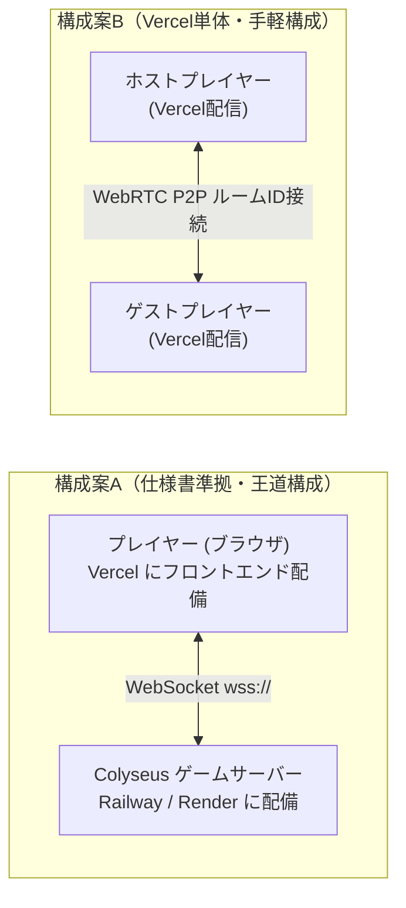

# Life Board - 3D-GDD（3Dゲームデザイン・設計仕様書）

> 本ドキュメントは、[online_board_game_spec_summary.md](../online_board_game_spec_summary.md) およびUIデザインリファレンス画像に基づき、`web-3d-game-create` オーケストレーション用に策定した3Dゲーム設計仕様書です。

---

## 1. プロダクト概要・世界観

- **タイトル**: **Life Board（ライフボード）**
- **ジャンル**: 3D不動産運用 × 人生キャリア・オンラインボードゲーム（モノポリー × 人生ゲーム）
- **ビジュアルトーン**:
  - 明るくクリーンなモダン・スタイライズド3D（爽やかなスカイブルーとホワイトを基調としたUI、緑豊かな街ジオラマとカラフルな立体ボードマス）
  - 4種類の個性豊かな3Dデフォルメキャラクター（カジュアル青年、制服少女、メガネ青年、ワンピース女性）＋5色のテーマカラー（ブルー、レッド、グリーン、イエロー、パープル）
- **プレイ人数**: 2人〜6人（オンラインマルチプレイ［Colyseus同期］＆ 1人でも即座に全機能をテスト・遊べるCPU/ローカルマルチ対応ハイブリッド構成）
- **勝敗条件**: ゲーム終了時（規定ターン消化 ／ 制限時間経過ラウンド終了 ／ サバイバル最後の1人）の **純資産額** で順位を決定

---

## 2. コアループと5フェーズ進行設計

### 2.1 純資産計算式（借金・担保廃止）
```text
純資産 = 所持現金 + 所有物件の評価額合計（基本購入価格 + 累積強化費用） + 永続型アイテムの評価額合計
```

### 2.2 1ターンの5フェーズ構成（制限時間：90秒 / AFK時5秒）

| フェーズ | フェーズ名 | 3D演出・カメラ・システム処理 |
| :--- | :--- | :--- |
| **Phase 1: ターン開始** | 状態確認・定期収支 | カメラが手番プレイヤーへズーム。商業施設の定期収益ポップアップ演出。刑務所収監時は脱出方法（保釈金300万 / 脱獄カード / 出目6挑戦）を選択 |
| **Phase 2: 移動前** | 戦略準備フェーズ | 俯瞰カメラ切り替え可能。消費アイテム使用（1ターン1回）、物件の銀行売却（総投資額の70%）、他プレイヤーとの取引申請（1ターン1回・応答20秒） |
| **Phase 3: 移動** | 3Dダイス＆移動 | Cannon-es 3D物理ダイス（1〜6等確率・サーバー乱数同期）をロール！コマが1マスずつホップ移動。分岐マス到達時はルート選択UI表示。スタート通過時に給料＋家族生活費精算 |
| **Phase 4: 移動後** | マス効果処理 | 停止マスのイベント発動（未所有物件購入、自己物件Lv2/Lv3強化＆3Dビル建設アニメーション、通行料支払い、キャリア・ファミリー・イベント・ショップ・税金・刑務所処理） |
| **Phase 5: ターン終了** | 終了処理 | 状態効果更新、破産時はターン制公開競売（開始価格50%、+50万円単位、15秒タイマー、Lv維持）を実行し、次のプレイヤーへ手番移行 |

---

## 3. 3Dボードマップ・カメラ・物理演出設計

### 3.1 3Dボード構造（Three.js）
- **マップ規模**: 1周 **36マス**（メイン周回ルート28マス ＋ 要所2箇所の分岐サブルート8マス［キャリア・イベント重視ルート / 不動産・商業重視ルート］）
- **中央ジオラマ**: ボード内側には緑の木々、道路、街並みモニュメント、噴水広場、水辺を立体配置し、リファレンス画像通りの箱庭都市を構築。
- **マス種別（全9種）と色分け**:
  1. **スタートマス**（ゴールド／ゲート装飾）：通過時に職業給料（無職は初回のみ失業手当100万円、2回目以降0円）と家族生活費（配偶者50万、子供1人50万）を精算
  2. **土地・物件マス（約45%）**：エリアグループ色分け（1グループ2〜3マス、独占で収益1.5倍）。住宅地（通行料20%/50%/100%）、商業施設（定期収益10%/20%/30%）、特殊物件（所有数倍率ボーナス）
  3. **イベントマス（約15%）**：ランダム即時イベント（60%）／選択型ルーレット判定イベント（40%）
  4. **キャリアマス（ファミリーと合算で約15%）**：全7職種（会社員、公務員、エンジニア、医者、不動産ブローカー、投資家、芸能人）への就職・転職・Rank 1〜3昇進
  5. **ファミリーマス**：結婚（配偶者最大1人・ご祝儀）、出産（子供最大3人・育児手当）、家族イベントボーナス
  6. **ボーナスマス（特殊合算で約25%）**：臨時報酬獲得
  7. **ショップマス**：消費型アイテム（指定出目カード、通行料半減シールド、物件割引チケット、脱獄カード）および永続型資産アイテム（高級腕時計300万、不動産資格証500万、自家用クルーザー1,000万）の売買（所持上限3個）
  8. **税金マス**：純資産に応じた税金支払い（公務員は30%〜50%軽減）
  9. **刑務所マス / 分岐マス**：収監（最大3ターン拘束、収監中も物件収益受取可、取引不可）およびルート分岐選択

### 3.2 物件レベル別3Dモデル変化
- **Lv1（初期購入）**: 小型ハウス／小型ショップ（1階建て立体メッシュ＋所有者のカラーフラッグ）
- **Lv2（強化1段階：基本価格×50%）**: 中型マンション／商業ビル（2〜3階建て複合メッシュ）
- **Lv3（強化2段階：基本価格×100%）**: ランドマークタワー／大型ショッピングモール（高層ビル＋屋上装飾＋発光サイン）

### 3.3 カメラ制御（スマートカメラシステム）
- **追従モード（Follow Cam）**: 手番プレイヤーの移動・ダイスロール時に滑らかなLerp補間で追従。
- **俯瞰・フリーモード（Overview / Orbit Cam）**: ボード全体を見渡せるアイソメトリック俯瞰視点。マウスドラッグ回転・ホイールズームで全マスの物件状況を自由に確認可能（観戦モードでも使用）。
- **スポットライト演出カメラ**: 物件建設時、結婚・昇進時、破産競売時に該当マスや対象へフォーカス＆3Dパーティクル放出。

### 3.4 3D物理（Cannon-es）
- **3Dダイス（ルーレット）物理演算**: ボード中央上で3Dサイコロが物理バウンドして転がり、サーバー/ロジックが決定した出目（1〜6）にピタッと着地・強調表示される演出。
- **コマのジャンプ移動＆ビル建設バウンス**: マス移動時の放物線ホップと着地パーティクル、物件建築時のスケールバウンス演出。

---

## 4. UI画面構成（リファレンス画像準拠）

1. **タイトル画面 (`TitleView`)**:
   - 『Life Board』ロゴ＆立体ダイス、都市シルエット背景、「ゲームスタート >」「設定」「ヘルプ（ルール確認）」ボタン
2. **ルームロビー画面 (`LobbyView`) - 新デザインリファレンス準拠**:
   - **上部ヘッダーバー**:
     - 左上：「`← 戻る`」白いピルボタン（タイトル画面へ戻る）
     - 中央：「🏠 **ルームロビー**」タイトル＋ブルーのアンダーライン装飾
     - 右上：「`ルームID : 12345` 📋」白いピルバッジ（コピーアイコンクリックで招待URL/ルームIDをコピー、または別ルームID入力参加モーダルを表示）
   - **中央左カード（ルーム概要パネル）**:
     - 左側：街並みと大きな白いサイコロの角丸サムネイル画像
     - 右側：編集可能なルームタイトル（「**たのしい人生ゲーム** ✏️」）、`🏁 ゲームモード`（規定ターン制 30ターン等）、`🕒 プレイ時間`（約30分）、`👥 参加人数`（2 / 6）
     - 下部バー：淡いブルーのステータスバー「`ℹ️ プレイヤーが集まるのを待っています...`」（友達のルームIDで参加するボタンも併設）
   - **中央右カード（参加プレイヤーパネル）**:
     - ブルーのヘッダー「`👥 参加プレイヤー`」
     - 6枠のリスト：参加済み枠はテーマカラーの丸ドットアイコン＋プレイヤー名＋ホスト王冠 `👑`（クリックでキャラクター・カラー・名前変更可能）。空き枠はグレーのユーザーアイコン＋「`募集中...`」（クリックでCPU追加または人間追加）
   - **下部ボトムバー（開始・条件設定ドック）**:
     - 左側：「`⚙️ 終了条件`」ラベル＋「`🔄 規定ターン制 (30ターン)`」切替ピルボタン（クリックで規定ターン制10/20/30/50ターン・制限時間制15/30/45分をサイクル切替または選択）
     - 中央：縦区切り線＋「`🕒 開始まで`」＋カウントダウン表示（`00:01:30` 形式のロビー待機タイマー）
     - 右側：ゴールドイエローの立体グラデーションボタン「**`▶ ゲーム開始`**」
3. **キャラクター選択画面 (`CharacterSelectView`)**:
   - 4体のキャラクターモデル・イラスト選択（左右切替）、5色のテーマカラー選択、「決定」ボタン
4. **メインゲームHUD (`BoardHUD`)**:
   - 左上：現在の手番プレイヤーカード（アバター、名前、所持金、職業・ランク、家族アイコン）
   - 上部中央：残り思考時間タイマー（「🎲 あと 60 秒」）＆ 現在ターン数 / フェーズ表示
   - 右側：全プレイヤー情報ダッシュボード（順位、名前、所持金、純資産、物件数/上限、アイテム数、接続状態。クリックで所有物件・独占詳細モーダル表示）
   - 左下：3Dダイス出目インジケーター ＋ メインアクションボタン（「サイコロを振る」「アイテム」「取引」「物件売却」「ターン終了」などフェーズ別表示）
   - 中央モーダル：物件購入・強化確認、選択型イベント、ショップ、プレイヤー間取引（20秒タイマー）、公開競売（15秒タイマー）、分岐選択矢印UI
5. **ゲーム結果画面 (`ResultView`)**:
   - 最終純資産ランキング（1位〜6位、王冠アイコン、純資産総額）
   - 選択プレイヤーの「資産内訳（現金・物件・アイテム）」円グラフ（SVG/Canvasチャート）
   - 特別称号表彰（不動産王、大家族賞、キャリアマスター、キャッシュキング）
   - 「ロビーに戻る」ボタン

---

## 5. 5つの専門3Dサブエージェント分担定義

| サブエージェント | 担当ファイル | 具体的な実装・生成内容 |
| :--- | :--- | :--- |
| **`game-3d-asset-specialist`** | `public/assets/textures/*`<br>`src/assets/asset-manifest.ts` | ・サブエージェント（`image-generator`等）による不足素材イメージ生成（タイトルロゴ背景、ロビー用街プレビュー、4キャラクター立ち絵＆アバター、地面・水面・ビル壁面テクスチャ）<br>・Three.js複合ジオメトリによる3Dキャラクターコマ（4種×5色）、物件ビルモデル（住宅・商業・特殊のLv1〜Lv3）、3Dダイス、木々・噴水・ゲート等のプロシージャルメッシュ生成ファクトリ |
| **`game-3d-audio-specialist`** | `src/audio/sound-manager.ts` | ・Web Audio API + `THREE.PositionalAudio` による立体音響＆プロシージャルサウンド合成<br>・サイコロ転がり音、コマ移動ホップ音、物件購入レジ音、ビル建設ファンファーレ、イベント成功/失敗ジングル、結婚・昇進祝福ファンファーレ、競売カウントダウン音、爽やかなシティポップ/ボードゲーム風BGMループ |
| **`game-3d-logic-specialist`** | `src/config/constants.ts`<br>`src/entities/*`<br>`src/systems/*`<br>`src/network/*` | ・確定仕様書（全9種マス、36マス＋2分岐マップ生成、5フェーズ管理、90秒/AFK5秒タイマー、全7職業×3ランク＆パッシブ能力、家族生活費、無職初回手当100万、住宅/商業/特殊物件＆独占1.5倍、破産判定＆ターン制公開競売、プレイヤー間取引、刑務所3ターン、純資産＆特別称号計算）の完全実装<br>・Colyseus状態同期クライアント＆サーバー（および単体起動ですぐ遊べるローカル/スマートAIプレイヤーエンジン）の統合<br>・Cannon-es 3Dダイス物理シミュレーション |
| **`game-3d-scene-specialist`** | `src/scenes/MainScene.ts`<br>`src/scenes/UIManager.ts`<br>`src/main.ts`<br>`src/style.css` | ・Three.js 3Dボードシーン構築（太陽光シャドウ、水面・空の演出、追従カメラ＆俯瞰Orbitカメラ切替、紙吹雪・コイン・建設パーティクル等のJuice演出）<br>・リファレンス画像完全準拠の5画面UI（タイトル、ルームロビー、キャラクター選択、メインHUD＋モーダル群、円グラフ付きゲーム結果画面） |
| **`game-3d-qa-specialist`** | `docs/qa-report.md` | ・`npx tsc --noEmit` および `npm run build` による静的型検査・バンドル検証<br>・アセットパス、3Dメモリ解放、ルール計算式の整合性チェックと自律修復ループ |

---

## 6. デプロイ・オンラインマルチプレイ通信アーキテクチャ設計

### 6.1 Vercelデプロイのメリット・デメリット（技術的特性）

| 項目 | 内容・影響 |
| :--- | :--- |
| **Vercelの強み（メリット）** | ・Three.jsの3Dアセット・静的フロントエンド（Viteビルド成果物）を高速CDNで無料配信できる。<br>・HTTPS（SSL）が自動適用され、URLを友達にシェアするだけで即アクセス可能。 |
| **Vercelの制約（デメリット1：WebSocket常駐不可）** | ・Vercelのバックエンド（Serverless Functions）は短時間で終了するステートレス仕様のため、**Colyseusのような「試合中（30〜45分間）常時接続を維持し、90秒ターンタイマーや部屋状態をメモリ保持するWebSocketゲームサーバー」をVercel単体で動かすことはできない**。 |
| **Vercel単体＋P2P方式にした場合のデメリット（デメリット2：ホスト依存）** | ・もしバックエンドサーバーを置かずWebRTC（PeerJS）等でVercel単体マルチプレイにした場合、**ホスト（部屋を作った人）がブラウザを閉じたり通信切断すると部屋全体が維持できなくなる**。また、厳格なファイアウォール環境ではP2P接続が失敗する場合がある。 |

---

### 6.2 友達とオンライン対戦するための推奨デプロイ構成（3案比較）



| 比較項目 | 【推奨案A】Vercel（フロント）＋ Railway / Render（Colyseusサーバー） | 【手軽案B】Vercel単体デプロイ ＋ WebRTC (PeerJS) P2P同期 | 【最小案C】Vercel単体デプロイ（1画面共有 / Discord等） |
| :--- | :--- | :--- | :--- |
| **特徴** | 確定仕様書（Colyseusサーバー権威型）を100%実現する本格オンライン構成 | サーバー代・バックエンド管理が完全ゼロ。Vercelに上げるだけで別端末対戦が可能 | 追加開発ゼロ。今すぐVercelに上げて1台の画面または画面共有で遊べる |
| **友達との遊び方** | 各自のPC/スマホでVercelのURLを開き、6桁のルームIDを入力して合流 | 各自のPC/スマホでVercelのURLを開き、6桁のルームIDを入力してP2P合流 | ロビーで「＋ 人間プレイヤー追加」を押し、順番に操作 |
| **切断・AFK耐性** | **◎ 非常に強い**（誰が切断してもサーバーが5秒AFK自動処理を引き継ぎ、いつでも再接続復帰可能） | **△ ホストに依存**（ゲスト切断時は復帰可能だが、ホストが閉じると試合終了） | **ー**（1端末で共有操作） |
| **デプロイの手間** | フロントをVercel、サーバー（`server/`）をRailwayまたはRenderへデプロイ（計2箇所） | **◎ Vercel 1箇所のみ**（静的ホスティングのみで完結） | **◎ Vercel 1箇所のみ** |
| **コスト** | フロント無料 ／ サーバーは月5ドル程度（またはRender等の無料枠※スリープあり） | **完全無料** | **完全無料** |

---

### 6.3 採用方式：案B（Vercel単体デプロイ ＋ PeerJS WebRTC P2Pホスト権威同期）詳細設計

ユーザーの選択に基づき、Vercel 1箇所への静的デプロイのみで友達と別々のPC・スマホからルームID（または招待URL）で通信対戦できる **PeerJS (WebRTC DataChannel) ホスト権威型P2P同期システム** を実装する。

#### 1. 接続・ルームID解決フロー
- **Peer ID命名規則**: ルームID `XXXXXX`（6桁英数字）に対し、ホストのPeer IDを `lifeboard-p2p-room-XXXXXX` とする。
- **ホスト（部屋作成者）**:
  - ロビーで「🌐 オンライン部屋を作成」またはデフォルト起動により、PeerJSで `lifeboard-p2p-room-{ROOM_ID}` をオープン。
  - 「🔗 招待URLをコピー」ボタンで `https://<デプロイ先URL>/?room={ROOM_ID}` をクリップボードにコピーし、友達に共有可能。
- **ゲスト（友達・参加者）**:
  - 招待URL（`?room=XXXXXX`）を開くか、ロビー画面上部の「🔑 ルームID入力」に6桁コードを入力して「参加」をクリックすると、ホストのPeerへWebRTC DataChannel接続を確立。
  - 空いているCPU枠または新規プレイヤー枠（最大6人）に人間プレイヤーとして割り当てられ、固有の `localPlayerId` を取得。

#### 2. P2Pメッセージプロトコル (`P2PMessage`)
- **ホスト → 全ゲスト配信 (`HostToClientMessage`)**:
  - `LOBBY_SYNC`: ロビー設定・参加プレイヤー一覧・ホスト状態の同期
  - `MATCH_START`: ゲーム開始通知（シード値、ルール設定、初期プレイヤーリスト、初期状態スナップショット）
  - `ENGINE_STATE_SYNC`: `GameEngine` の全状態スナップショット（タイル所有権・レベル、各プレイヤー資産・職業・家族・位置、現在フェーズ、各種モーダルコンテキスト、残り秒数）
  - `FX_DICE_ROLL`: 3D物理ダイスロール演出の同期発火
  - `FX_PLAYER_STEP`: 3Dキャラクターコマの1マスホップ移動アニメーション同期
  - `FX_POPUP`: 3D空間上の金額・祝福ポップアップエフェクト同期
  - `FX_LOG`: トースト＆ログ通知の同期
  - `MATCH_OVER`: ゲーム終了＆最終ランキング・特別称号の同期
- **ゲスト → ホスト送信 (`ClientToHostMessage`)**:
  - `JOIN_REQUEST`: プレイヤー名・希望キャラ・カラーでの参加または再接続リクエスト（保存済みセッションIDによる再接続復帰に対応）
  - `CUSTOMIZE_PLAYER`: ロビーでの名前・キャラクター・カラー変更
  - `PLAYER_ACTION`: ゲーム中の全17種プレイヤー操作コマンド（サイコロロール、刑務所選択、分岐選択、物件購入/強化/売却、キャリア選択、イベント選択、ショップ売買、トレード申請/応答、競売入札/パス、アイテム使用、ターン終了）のRPC送信

#### 3. 権威性と切断・再接続（仕様書13.1準拠）
- 乱数（サイコロ出目・イベント抽選）と90秒タイマーはすべて **ホスト側の `GameEngine` が一括管理（ホスト権威方式）** し、ゲスト側での不正や乱数ズレを防止。
- ゲストのWebRTC接続が切断された場合、ホスト側で該当プレイヤーの `isConnected = false` とし、5秒短縮タイマーによる自動進行を継続。ゲストが再度同じルームに接続すると元のプレイヤーIDに再バインドされ、手動操作へ復帰する。


