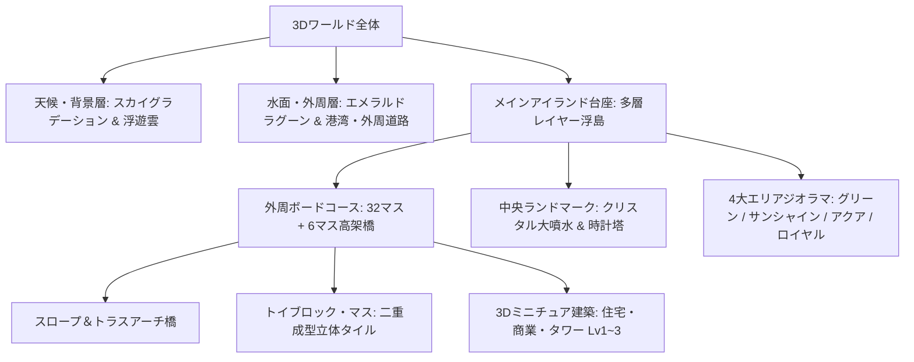

# 🗺️ Life Board 3Dマップ全面リニューアル設計仕様書 (Map Redesign V2)

**作成日:** 2026-11-02  
**ステータス:** Phase 1 (第1マップ: Toytopia City) 実装完了・ビルド検証済 / Phase 2 (複数マップ拡張) 待機中  
**担当:** 3D Asset & Scene Specialist

---

## 1. デザインコンセプト & ヒアリング決定事項

ユーザーヒアリングに基づき、従来の平坦なボードから**「触りたくなる立体感・高低差・生き生きとした動的ジオラマ」**を備えた本格3Dトイ・アイランドへと1から全面刷新します。
また、**「まず第1マップを最高品質で完成させ、その後複数マップ（テーマ別マップ）を容易に追加・切り替え可能なマルチマップ設計」**を採用します。

| 項目 | 決定仕様 | 詳細方針 |
| :--- | :--- | :--- |
| **開発フェーズ方針** | **段階的マルチマップ展開** | **Phase 1 (今回):** 第1マップ「トイ・トピア (Toytopia City)」の3Dデザイン＆ジオラマを1から完全制作。<br>**Phase 2 (次回以降):** 複数マップ選択機能（ファンタジー島、サイバーシティ、トロピカルリゾート等）の実装。 |
| **世界観・テーマ (Map 1)** | **ポップ＆リッチな3D都市ジオラマ** | Monopoly GO / ダイスドリームズ調。青空に浮かぶ立体浮遊島。鮮やかな色彩とプラスチック・レゴのような光沢感・厚み。 |
| **コース・構造** | **立体高低差＆立体橋梁アイランド** | メイン外周（32マス）と高架ショートカット（6マス）に自然なスロープとアーチ橋（ウッドデッキ・トラス橋）を架け、中央のシンボルをぐるりと囲む立体構造。 |
| **質感・マテリアル** | **トイブロック＆チャンキーベベル** | マスや建物を「厚みのあるトイブロック（丸みのあるベベル・二重成型・白枠）」で表現。標準絵文字は使わず専用ベクター・ピクトグラムを鮮明に刻印。 |
| **中央ランドマーク** | **動的シンボルランドマーク** | 中央に「光彩を放つクリスタル噴水広場 ＋ 時計塔 ＋ ダイスコロシアム」を複合配置。水しぶきや回転演出を付与。 |
| **動的ライフ演出** | **生きたジオラマ空間** | 周回道路を走るミニチュアカー（イエローキャブ/バス）、風を受けて回る風車、ゆっくり漂う立体雲、波打つ水面。 |
| **エリア景観変化** | **4大個性エリアの景観差別化** | ① グリーンヒルズ（芝生と花・並木道）<br>② サンシャイン＆ネオン商業街（カフェ・看板・テラス）<br>③ アクアベイ＆港町（木製ボードウォーク・ヨット・波止場）<br>④ ロイヤル＆ゴールドヒルズ（大理石・黄金街灯・噴水） |
| **盤面外郭タウン＆ミニ浮島 (新設)** | **外周リム建物 ＆ 4つのサテライト小島** | 盤面外側の寂しさを解消するため、マスの外周リム（半径17〜19）に4大エリア連動の外郭建物群を配置。<br>さらに東西南北の遠景に、テーマ別のミニトイ浮島（風車の島、電波塔の島、孤島灯台、ロイヤルオアシス島）を浮かべて圧倒的なジオラマ奥行き感を演出。 |

---

## 1.1 マルチマップ拡張アーキテクチャ設計

将来の複数マップ展開に対応するため、マップ定義をインターフェース化し、テーマごとにジオラマ・マテリアル・配置を切り替え可能な構造を構築します。

```typescript
export interface MapThemeConfig {
  id: string;
  name: string;
  description: string;
  skyColors: { top: string; bottom: string; fog: number };
  waterColor: number;
  islandBaseColors: { grass: number; stone: number; base: number };
  createDiorama: () => THREE.Group;
  soundtrackTheme?: string;
}
```
- **Map 1: `toytopia_city` (トイ・トピア / ポップ都市ジオラマ) ← 今回実装**
- **Map 2 (拡張予定): `magic_sky_islands` (空飛ぶ魔法の浮島・クリスタルファンタジー)**
- **Map 3 (拡張予定): `cyber_neon_metro` (ネオン煌めく近未来サイバーパンク)**
- **Map 4 (拡張予定): `tropical_paradise` (南国ビーチ＆テーマパーク)**

---

---

## 2. 3Dジオラマ・空間アーキテクチャ



### 2.1 浮島ベース（Floating Island Slab）の多層構造
従来の単一ボックスから、3層の立体浮島構造へ変更：
1. **トップサーフェス（芝生・舗装層）**:
   - 角丸の立体アイランドスラブ（ライムグリーン `#84cc16` 〜 エメラルド `#10b981`）。
   - 歩道と車道、レンガ舗装がエリアごとに敷き詰められる。
2. **中間ストーン層（ベベル付き岩盤層）**:
   - オフホワイト・サンドストーン調（厚み `0.8`）。
   - おもちゃのフィギュア台座のようなクリーンな面取り（Bevel）。
3. **ボトムベース（浮遊台座層）**:
   - ディープスレート `#334155` の浮遊土台。下部に微細なアンビエントシャドウ。

### 2.2 中央ランドマーク（Central Dynamic Landmark）
マップ中央（従来の平坦なカード置き場）を、視覚的中心となる豪華ジオラマへ昇華：
- **クリスタル大噴水広場**:
  - 円形の大理石プール、透き通るブルー水面、中央の透明クリスタルモニュメント。
  - 上下に微小に脈動・回転する水しぶきエフェクト。
- **トイ・クロックタワー（時計塔）**:
  - 赤い三角屋根、白とレンガのタワー、文字盤。
- **立体ダイスコロシアム（中央台座）**:
  - ダイスを振った際にサイコロがバウンドして落ち着くトレイをゴールドの縁取りで高級感アップ。

### 2.3 外郭タウン＆サテライトミニ浮島仕様 (新設)

#### 1. メイン浮島外郭リムの建物群 (Outer Town)
浮島台座を `39.0 x 39.0` に拡大し、マス（`±14`）の外側 `±17.5〜±19.0` に以下の建物を配置：
- **北西外郭（グリーン住宅街）**: 三角屋根のトイコテージ（チムニー煙突付き）、白いフェンス、トイツリー並木、街灯
- **北東外郭（サンシャイン商業街）**: 窓明かりテクスチャ付きのカラフルな高層トイビル、ネオンルーフ、看板
- **南西外郭（アクアベイ港湾）**: 赤レンガの港湾倉庫、コンテナ、桟橋、係留ボート、浮標
- **南東外郭（ロイヤルパレス）**: 大理石の高級高層タワー、ゴールドドーム、クリスタルアーチ、大理石ピラー

#### 2. 4つのサテライト浮島 (Satellite Islands)
- **北西 `[-26, -24]`**: 『風車の丘島』 - トイ風車、緑の芝生、トイツリー
- **北東 `[26, -25]`**: 『スカイタワー島』 - 赤白の電波アンテナ塔、サイバービル
- **南西 `[-27, 25]`**: 『アクアラグーン島』 - 白いミニ灯台、砂浜ビーチ、ヤシの木
- **南東 `[26, 26]`**: 『ゴールドクラウン島』 - 巨大な王冠モニュメント、黄金オベリスク
- 各浮島は `y = -0.4` 付近にふんわり浮遊し、波打つ水面ディスクの上に自然に溶け込む。

---

## 3. マス（タイル）のトイブロック仕様

各マスは、従来の薄いプレートから「カチッとはまるトイブロック（LEGO/デュプロのような触感）」へ再設計。

### 3.1 タイルメッシュ構造
```
[ 上面: 高精細UVラベルプレート（白背景・鮮明な専用ベクターアイコン・エリアカラー帯） ]
[ 中間: アクリル/プラスチック光沢ハイライト層（薄いベベルリング） ]
[ 下面: 厚み0.45のソリッドホワイトABS樹脂ブロック（castShadow / receiveShadow） ]
```

### 3.2 エリア・マス種別ごとのカラー＆モチーフ
- **START（スタート）**: 豪華ゴールド `#fbbf24` ＋ 市松模様チェッカーフラッグ ＋ アーチゲート
- **グリーンヒルズ (住宅)**: エメラルドグリーン `#22c55e` ＋ ウッドフェンス
- **サンシャイン通り (商業)**: ウォームオレンジ `#f59e0b` ＋ オーニングストライプ
- **アクアベイエリア (港町)**: マリンブルー `#06b6d4` ＋ 波模様・浮き輪
- **メトロポリタン (オフィス)**: インディゴブルー `#3b82f6` ＋ ガラスウォール
- **ロイヤル＆ゴールド (超高級)**: パープル `#8b5cf6` & ゴールド `#d97706` ＋ 黄金トリム
- **特殊マス（EVENT / CAREER / FAMILY / SHOP / TAX / JAIL）**:
  - 各マス専用の立体シンボル（宝箱、ブリーフケース、ハート、ショップテント、コイン金庫、鉄格子）をタイル上に小さく配置して直感性を極大化。

---

## 4. 動的ライフ演出＆アニメーション

1. **ミニチュア交通システム**:
   - 外周道路を周回するイエローキャブ（タクシー）と赤い2階建てバスがスムーズにコーナリング走行。
2. **風車＆水車**:
   - グリーンヒルズとアクアベイに、ゆっくり回転する羽根を持つトイ風車・水車を配置。
3. **低空を流れる立体雲**:
   - ジオラマの周囲をふんわりと旋回する3層のローポリ雲（影を落としながら移動）。
4. **噴水のウォーターパルス**:
   - 中央噴水から吹き上がる水滴パーティクル。

---

## 5. 実装ステップとファイル構成

1. **Step 1: 3Dアセット生成ロジックの刷新 (`src/assets/asset-manifest.ts`)**
   - `createTileMesh`: トイブロック化・立体二重成型・シャドウ＆ベベル追加
   - `createCityCenterDiorama`: 大噴水広場、時計塔、4大エリアの景観オブジェクト、風車・車
   - `createBuildingMesh`: レベル1〜3の建築ミニチュアのトイデザイン強化
2. **Step 2: 3Dシーンとアニメーションループの統合 (`src/scenes/MainScene.ts`)**
   - 浮島ベースの多層化、水面エフェクト、動的オブジェクト（車・風車・雲・噴水）のアニメーション更新
3. **Step 3: ビルド検証・型チェック・動作確認**
   - `npm run build` による TypeScript 型整合性チェックと動作検証

