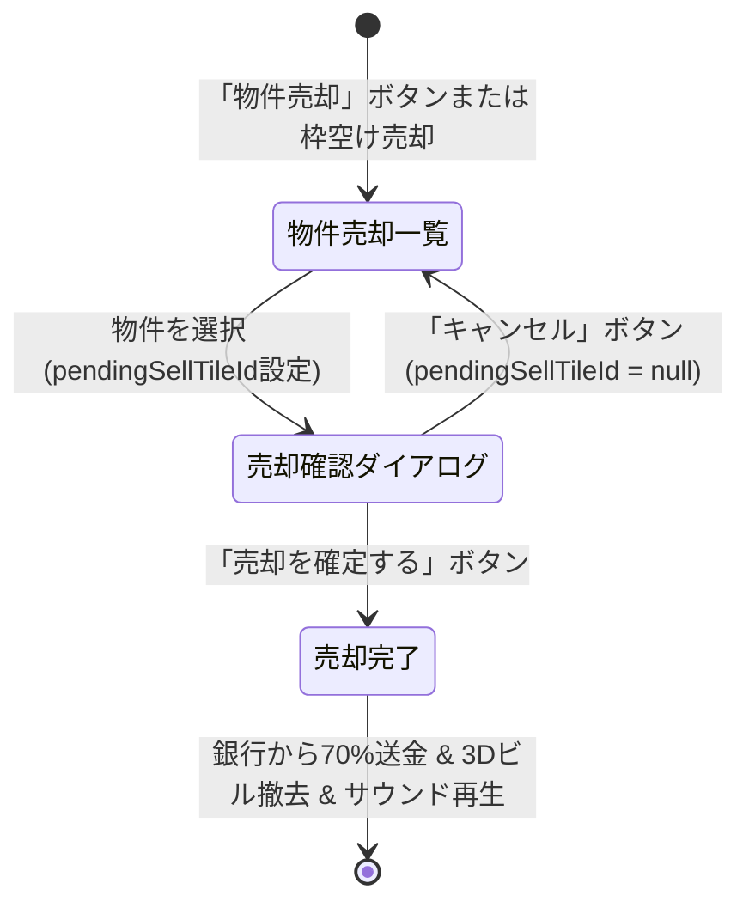

# 🏢 物件売却確認ダイアログ仕様書 (Property Sell Confirm Spec)

**作成日:** 2026-11-02  
**ステータス:** 設計完了・実装中  
**対象コンポーネント:** `src/scenes/UIManager.ts` / UIスタイル

---

## 1. 概要 & ヒアリング決定事項

誤タップ・誤操作による大切な物件の意図しない売却を防止するため、物件売却時に**「本当に売却しますか？」というトイカード調の確認ダイアログ**を挟む仕様へとリニューアルします。

| 項目 | 決定仕様 |
| :--- | :--- |
| **対象の売却アクション** | ① HUDメニュー「🏢 物件売却」（`BANK_SELL` モーダル） ② 物件購入モーダル内の「所有上限到達時の枠空け売却」（`data-inline-sell`） ※全売却操作に一貫して確認を適用 |
| **ダイアログデザイン** | トイ・アイソメトリック調の立体カード（`.toy-panel-slab`） ・物件名、エリアカラーバッジ、強化レベル（Lv1〜3） ・評価額と売却受取額（+〇〇万円 / 70%換金）の明確な提示 ・売却に伴う警告（通行料喪失・再取得の難しさ） |
| **アクション** | ・**「🏢 売却を確定する (+〇〇万円)」**（ゴールド／アクセントボタン） ・**「キャンセル（戻る）」**（ホワイトトイボタン） |

---

## 2. 状態遷移とUIフロー

---

## 3. 確認ダイアログの表示構成（トイカード仕様）

1. **ヘッダー**:
   - `⚠️ 物件の売却確認`
2. **物件カード（プレビュー）**:
   - エリアカラーの帯 ＋ アイコン
   - 物件名（例: 『ひまわりコーポ (Lv2)』）
   - グループ名（例: 『グリーンヒルズ』）
3. **換金情報スラブ**:
   - 投資評価額: `300万円`
   - **銀行売却受取額: `+210万円`（70%換金）**
   - 損失額: `-90万円`
4. **警告メッセージ**:
   - 「※売却すると所有権が消失し、他プレイヤーからの通行料収入が得られなくなります。」
5. **フッターボタン**:
   - `[ キャンセル ]` / `[ 🏢 本当に売却する (+210万円) ]`

